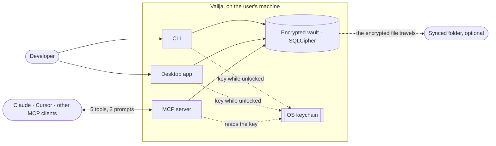

Valija is a local-first, end-to-end encrypted vault for a developer's AI context. People who work
with several AI tools (Claude Code, Claude Desktop, Cursor…) lose the thread every time they switch:
decisions taken, progress, preferences. Valija keeps that distilled context **on the user's own
machine, encrypted with their passphrase**, and serves it to any MCP-capable tool. There is no
Valija cloud, no account and no telemetry; to use one vault on several machines, the user points it
at a folder their own sync client already replicates.

**Business vocabulary**

- **Vault** — the encrypted file. Only the passphrase or the recovery kit opens it.
- **Project** — groups the context of one piece of work; identified by a slug.
- **Context item** — one piece of memory: a `decision`, `progress`, `preference`, `fact`,
  `handoff`, or `imported` conversation chunk.
- **Context pack** — what an AI receives when it asks for a project's context.
- **Unlock / lock** — while unlocked, the key sits in the OS keychain so AI tools can read and
  write; locking removes it. An idle vault locks itself.
