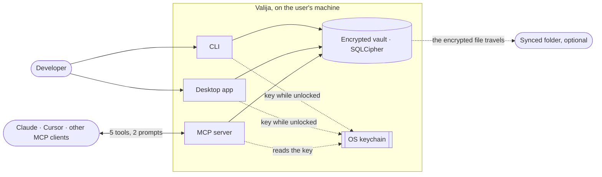

<!-- Generated by tools/living-docs — do not edit. Run `npm run docs`. -->

# Valija developer guide

Valija is a local-first, end-to-end encrypted vault for a developer's AI context. People who work
with several AI tools (Claude Code, Claude Desktop, Cursor…) lose the thread every time they switch:
decisions taken, progress, preferences. Valija keeps that distilled context **on the user's own
machine, encrypted with their passphrase**, and serves it to any MCP-capable tool. There is no
Valija cloud, no account and no telemetry; to use one vault on several machines, the user points it
at a folder their own sync client already replicates.

**Business vocabulary**

- **Vault** — the encrypted file. Only the passphrase or the recovery kit opens it.
- **Project** — groups the context of one piece of work; identified by a slug.
- **Context item** — one piece of memory: a `decision`, `progress`, `preference`, `fact`,
  `handoff`, or `imported` conversation chunk.
- **Context pack** — what an AI receives when it asks for a project's context.
- **Unlock / lock** — while unlocked, the key sits in the OS keychain so AI tools can read and
  write; locking removes it. An idle vault locks itself.

## Understand the product

Each flow page opens with the business view: who, why, the rules, what can go wrong.

### Vault lifecycle

- [Change the passphrase](flows/change-passphrase.md) — To make the old passphrase and the old recovery kit useless for the vault from now on, by
re-encrypting the whole vault under a new key, without exporting or losing anything.
- [Check vault status](flows/check-vault-status.md) — One glance answers "can my AI tools use the vault right now?" and "is it safe to switch devices?",
without opening or changing any context.
- [Create a vault](flows/create-vault.md) — To get an encrypted place for AI context that only their passphrase (or their recovery kit) can
open.
- [Idle auto-lock](flows/idle-auto-lock.md) — An unlocked vault left alone for a long time is a risk.
- [Lock the vault](flows/lock-vault.md) — Locking removes the key from the OS keychain, so neither the user's tools nor anything else on the
machine can read the vault until it is unlocked again.
- [Unlock the vault](flows/unlock-vault.md) — While the vault is locked, no AI tool can read or save context.
- [Upgrade the vault on unlock](flows/upgrade-vault-on-unlock.md) — New versions sometimes change how data is stored.

### Working with context

- [Browse a project](flows/browse-project.md) — To review the project's memory item by item: what the AI tools saved, and the imported
conversations, newest first.
- [Detect the project from the working folder](flows/detect-project.md) — So that the project a folder is linked to is used automatically, while a project named
explicitly always wins.
- [Edit an item](flows/edit-item.md) — To fix an item in place — its wording, tags or type — so the vault keeps one accurate item instead
of a wrong one and a correction.
- [Export a project](flows/export-context-pack.md) — Context in Valija is never locked in.
- [Hand off a conversation to another tool](flows/hand-off-conversation.md) — To package "where we are" (goal, what was done, blockers, the exact next step, relevant files) so
the next tool can pick up seamlessly instead of starting from zero.
- [Link a folder or repository to a project](flows/link-project-folder.md) — So that commands run in that folder, and AI tools working in it, find the right project without
the user naming it every time.
- [List projects](flows/list-projects.md) — To see what the vault holds at a glance: every project, how many items it has, and when it was
last active.
- [Load a project's context pack](flows/load-context-pack.md) — To give the AI the right context at the start of a session (pinned notes, the latest handoff,
decisions, preferences, progress, facts) without the user pasting anything.
- [Pin or archive an item](flows/pin-or-archive-item.md) — So the context pack an AI tool loads leads with what the user says matters and leaves out what no
longer holds, without deleting anything.
- [Save context from an AI tool](flows/save-context.md) — So that what was learned in one session (a decision and its reason, progress, a preference, a fact)
is available to any other tool, in any later session, on any of the user's machines.
- [Search saved context](flows/search-context.md) — To find a piece of context by its words, across every project or within one, including imported
conversations that never appear in a context pack.

### Bringing history in

- [Import chat history](flows/import-chat-history.md) — A fresh vault is empty.

### Connecting AI tools

- [Connect an AI tool](flows/connect-ai-tool.md) — An AI tool can only use Valija once its configuration knows how to start Valija's MCP server.
- [Serve AI tools over MCP](flows/serve-mcp.md) — MCP is how AI tools talk to Valija: through it they save, hand off, load, search and list context,
whichever tool and machine the user is on.

### Health and devices

- [Check my setup](flows/check-setup.md) — One command answers "is my Valija healthy?": the runtime, the encryption module, the keychain, the
vault, sync safety, lineage, auto-lock, and whether each AI tool is connected.
- [Use one vault on several devices](flows/multi-device-sync.md) — To have the same AI context on every machine without any Valija server or account: the encrypted
file travels through the sync client the user already trusts.

### Desktop app

- [Desktop preferences](flows/desktop-preferences.md) — The app follows the operating system's theme and language by default; the user can override both
and have the choice remembered on this device.
- [Move the vault to another folder](flows/relocate-vault.md) — To use one vault on several machines, or simply to keep it in a better place, without exporting
and re-importing anything, and without breaking the AI tools that already use it.

## I'm going to touch code

Start with the architecture, then the reference tables; every flow page ends with
a sequence diagram and steps linked to the code.

- [Architecture](architecture.md)
- [CLI commands](reference/cli.md)
- [Errors](reference/errors.md)
- [Desktop IPC channels](reference/ipc.md)
- [Mcp](reference/mcp.md)
- [CLI ↔ desktop parity](reference/parity.md)
- [Use cases](reference/use-cases.md)
