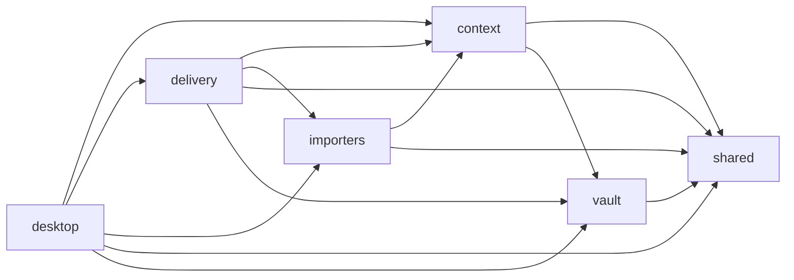

<!-- Generated by tools/living-docs — do not edit. Run `npm run docs`. -->

[← Guide](README.md)

# Architecture

## Modules and layers

One bounded context per `src/` folder, each split into **domain** (pure rules) ← **application** (use cases and ports) ← **infra** (adapters: SQLCipher, Argon2, keychain, files). `delivery` (CLI, MCP) and the desktop app are the entry points. Each cell lists the kind folders found in that layer; `delivery` has no layers of its own. Module names link to their behaviour spec.

| Module | domain | application | infra |
|---|---|---|---|
| [context](../../specs/context.md) | entities/, services/, values/, 1 file(s) | dto/, ports/, services/, use-cases/ | 3 file(s) |
| [delivery](../../specs/delivery.md) | entry points: cli/, mcp/, 5 file(s) | — | — |
| [desktop](../../specs/desktop.md) | — (uses the src/ use cases) | policies/, ports/, services/ | main/infra/, main/ipc/, preload/, renderer/, shared/ |
| [importers](../../specs/importers.md) | entities/, services/, values/, 1 file(s) | ports/, use-cases/ | parsers/, 2 file(s) |
| [shared](../../specs/shared.md) | 1 file(s) | ports/, 1 file(s) | migrations/, 4 file(s) |
| [vault](../../specs/vault.md) | services/, values/, 1 file(s) | policies/, ports/, services/, use-cases/ | 9 file(s) |

## Module dependencies

Computed from the real `import` statements (type-only imports included). An arrow means "imports from"; edges are shown as they are, without judgement.

## Composition: which adapter fills each port

Read from `buildContainer` in `src/delivery/container.ts`. Each arrow goes from a use case to what it receives, labelled with the port (constructor parameter type) it is received as.

```mermaid
flowchart LR
  n_Argon2VaultCrypto["Argon2VaultCrypto"]
  n_CheckVaultUpgrade["CheckVaultUpgrade"]
  n_CreateVault["CreateVault"]
  n_EditItem["EditItem"]
  n_FileDeviceIdentity["FileDeviceIdentity"]
  n_FileExportReader["FileExportReader"]
  n_FileVaultFolder["FileVaultFolder"]
  n_FileVaultMover["FileVaultMover"]
  n_FileVaultStore["FileVaultStore"]
  n_GetContextPack["GetContextPack"]
  n_ImportConversations["ImportConversations"]
  n_ImportItems["ImportItems"]
  n_ListProjects["ListProjects"]
  n_LockVault["LockVault"]
  n_OsKeychain["OsKeychain"]
  n_RelocateVault["RelocateVault"]
  n_SaveContext["SaveContext"]
  n_SearchContext["SearchContext"]
  n_SetItemArchived["SetItemArchived"]
  n_SetItemPinned["SetItemPinned"]
  n_ShowProject["ShowProject"]
  n_SqliteVaultSessions["SqliteVaultSessions"]
  n_UnlockVault["UnlockVault"]
  n_VaultStatus["VaultStatus"]
  n_parserRegistry["parserRegistry"]
  n_paths["paths"]
  n_systemClock["systemClock"]
  n_ttlMinutes["ttlMinutes"]
  n_ulidIds["ulidIds"]
  n_CheckVaultUpgrade -->|VaultCrypto| n_Argon2VaultCrypto
  n_CheckVaultUpgrade -->|VaultStore| n_FileVaultStore
  n_CreateVault -->|VaultCrypto| n_Argon2VaultCrypto
  n_CreateVault -->|DeviceIdentity| n_FileDeviceIdentity
  n_CreateVault -->|VaultStore| n_FileVaultStore
  n_CreateVault -->|KeychainPort| n_OsKeychain
  n_CreateVault -->|Clock| n_systemClock
  n_CreateVault -->|IdGenerator| n_ulidIds
  n_EditItem -->|VaultSessions| n_SqliteVaultSessions
  n_EditItem -->|Clock| n_systemClock
  n_GetContextPack -->|VaultSessions| n_SqliteVaultSessions
  n_GetContextPack -->|Clock| n_systemClock
  n_ImportConversations -->|ExportReader| n_FileExportReader
  n_ImportConversations -->|UseCase| n_ImportItems
  n_ImportConversations -->|ParserRegistry| n_parserRegistry
  n_ImportConversations -->|Clock| n_systemClock
  n_ImportItems -->|VaultSessions| n_SqliteVaultSessions
  n_ImportItems -->|Clock| n_systemClock
  n_ImportItems -->|IdGenerator| n_ulidIds
  n_ListProjects -->|VaultSessions| n_SqliteVaultSessions
  n_LockVault -->|DeviceIdentity| n_FileDeviceIdentity
  n_LockVault -->|VaultFolder| n_FileVaultFolder
  n_LockVault -->|VaultStore| n_FileVaultStore
  n_LockVault -->|KeychainPort| n_OsKeychain
  n_RelocateVault -->|VaultFolder| n_FileVaultFolder
  n_RelocateVault -->|VaultMover| n_FileVaultMover
  n_RelocateVault -->|VaultStore| n_FileVaultStore
  n_RelocateVault -->|KeychainPort| n_OsKeychain
  n_RelocateVault -->|VaultPaths| n_paths
  n_SaveContext -->|VaultSessions| n_SqliteVaultSessions
  n_SaveContext -->|Clock| n_systemClock
  n_SaveContext -->|IdGenerator| n_ulidIds
  n_SearchContext -->|VaultSessions| n_SqliteVaultSessions
  n_SetItemArchived -->|VaultSessions| n_SqliteVaultSessions
  n_SetItemArchived -->|Clock| n_systemClock
  n_SetItemPinned -->|VaultSessions| n_SqliteVaultSessions
  n_SetItemPinned -->|Clock| n_systemClock
  n_ShowProject -->|VaultSessions| n_SqliteVaultSessions
  n_UnlockVault -->|VaultCrypto| n_Argon2VaultCrypto
  n_UnlockVault -->|DeviceIdentity| n_FileDeviceIdentity
  n_UnlockVault -->|VaultStore| n_FileVaultStore
  n_UnlockVault -->|KeychainPort| n_OsKeychain
  n_UnlockVault -->|Clock| n_systemClock
  n_VaultStatus -->|DeviceIdentity| n_FileDeviceIdentity
  n_VaultStatus -->|VaultFolder| n_FileVaultFolder
  n_VaultStatus -->|VaultStore| n_FileVaultStore
  n_VaultStatus -->|KeychainPort| n_OsKeychain
  n_VaultStatus -->|Clock| n_systemClock
  n_VaultStatus -->|number| n_ttlMinutes
```

