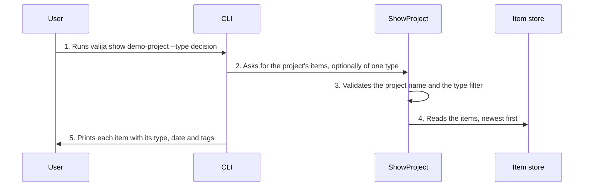

<!-- Generated by living-docs — do not edit. Run `npm run docs`. -->

[← Guide](../README.md)

# Browse a project

*Theme: Working with context*

## Who

The user, wanting to read what has been saved in one project.

## Why

To review the project's memory item by item: what the AI tools saved, and the imported
conversations, newest first.

## Business rules

- Items are listed newest first; archived items are not shown.
- The list can be filtered by type, including `imported`.
- The desktop app shows pinned items first, then the rest in their original order, and collapses
  long items behind a "show more" toggle.
- Browsing only reads; it never changes the vault.

## What can go wrong

- The vault is locked ([`VAULT_LOCKED`](../reference/errors.md#err-vault-locked)).
- The project does not exist ([`PROJECT_NOT_FOUND`](../reference/errors.md#err-project-not-found)).
- The type filter is not a known type ([`INVALID_ITEM_TYPE`](../reference/errors.md#err-invalid-item-type)).

## How it works

### Entry points

- CLI: [`valija show`](../reference/cli.md#cli-show) (`--type`)
- Desktop: [`content:show`](../reference/ipc.md#ipc-content-show) (the project screen)

### Sequence

### Steps

1. **User → CLI:** Runs `valija show demo-project --type decision` — [`showCommand`](../../../src/delivery/cli/content-commands.ts)
2. **CLI → ShowProject:** Asks for the project's items, optionally of one type — [`ShowProject`](../../../src/context/application/use-cases/show-project.use-case.ts)
3. **ShowProject → ShowProject:** Validates the project name and the type filter — [`parseStorableItemType`](../../../src/context/domain/values/item-type.ts)
4. **ShowProject → Item store:** Reads the items, newest first — [`SqliteContextItemRepository`](../../../src/context/infra/item-repo.ts)
5. **CLI → User:** Prints each item with its type, date and tags

## Errors

- [`VAULT_LOCKED`](../reference/errors.md#err-vault-locked) — unlock the vault first.
- [`PROJECT_NOT_FOUND`](../reference/errors.md#err-project-not-found) — there is no project with that name.
- [`INVALID_ITEM_TYPE`](../reference/errors.md#err-invalid-item-type) — the type filter is not a known type.
