<!-- Generated by tools/living-docs — do not edit. Run `npm run docs`. -->

[← Guide](../README.md)

# Change the passphrase

*Theme: Vault lifecycle*

## Who

The vault owner who wants a new passphrase: after a suspected leak, as routine hygiene, or after
forgetting the old one (proving ownership with the recovery kit instead).

## Why

To make the old passphrase and the old recovery kit useless for the vault from now on, by
re-encrypting the whole vault under a new key, without exporting or losing anything.

## Business rules

- The current credential is always asked for, even when the vault is unlocked: the current
  passphrase, or the recovery key from the kit (which resets a forgotten passphrase).
- The new key is derived from the new passphrase with the vault's existing salt and parameters, so
  `vault.json` never changes. The new passphrase must derive a different key than the current one.
- Every check happens before anything is written: the vault exists, its folder is settled (no
  sidecar, conflicted copy or leftover backup), the new passphrase is long enough, the current
  credential opens the vault, its schema is not newer than this Valija, the key really changes, and,
  in a cloud-synced folder, the user confirmed every other device is locked and synced. Then free
  disk space is checked (about three times the database size).
- A vault behind the current schema is re-encrypted as it is; it is not upgraded.
- The re-encryption happens in place, under an exclusive lock: a ciphertext backup
  (`vault.db.pre-rekey.bak`) is taken first, the database is re-encrypted, a fresh connection
  verifies it, and only then is the backup deleted. It counts as a write: the generation goes up by
  one, with this device as the writer.
- Crash-safe: a crash at any point leaves a vault the old or the new credential opens, or a backup
  the old one opens — never a vault nothing opens. A failure says nothing changed and the current
  passphrase still works.
- Afterwards, this device holds the new key and stays (or becomes) unlocked, and a new recovery kit
  is shown once. If the OS keychain refuses the new key, the change still succeeds but the vault is
  locked here; the old key is never left in the keychain.
- Old copies of the vault (backups, other devices that have not synced) still open with the old
  passphrase: re-encryption protects the vault from now on, not copies made before now.
- Neither passphrase nor key is ever written to a log, an error, a file or the IPC wire.

## What can go wrong

- No vault yet ([`VAULT_NOT_FOUND`](../reference/errors.md#err-vault-not-found)).
- The folder has leftover files, or a cloud folder's other devices were not confirmed as locked and
  synced ([`VAULT_FOLDER_UNSETTLED`](../reference/errors.md#err-vault-folder-unsettled)); nothing changed.
- The new passphrase is too short ([`WEAK_PASSPHRASE`](../reference/errors.md#err-weak-passphrase)).
- The current passphrase or recovery key is wrong ([`WRONG_PASSPHRASE`](../reference/errors.md#err-wrong-passphrase)).
- The vault was upgraded by a newer Valija ([`VAULT_SCHEMA_TOO_NEW`](../reference/errors.md#err-vault-schema-too-new)).
- The new passphrase is the current one ([`PASSPHRASE_UNCHANGED`](../reference/errors.md#err-passphrase-unchanged)).
- Not enough free disk space, or another Valija process held the vault for more than 5 s
  ([`STORAGE_ERROR`](../reference/errors.md#err-storage-error)); nothing changed.
- Re-encrypting fails or does not verify ([`REKEY_FAILED`](../reference/errors.md#err-rekey-failed)); the vault still opens with the
  current passphrase, restored from its backup if needed.

## How it works

### Entry points

- CLI: [`valija change-passphrase`](../reference/cli.md#cli-change-passphrase) (current passphrase prompt, or `--recovery-key`; `--yes` answers the cloud-folder question)
- Desktop: [`vault:changePassphrase`](../reference/ipc.md#ipc-vault-changepassphrase), then [`vault:readRecoveryKit`](../reference/ipc.md#ipc-vault-readrecoverykit) for the new kit, once

### Sequence

```mermaid
sequenceDiagram
  participant P1 as User
  participant P2 as CLI
  participant P3 as ChangePassphrase
  participant P4 as VaultFolder
  participant P5 as Argon2id
  participant P6 as VaultStore
  participant P7 as VaultRekeyer
  participant P8 as OS keychain
  P1->>P2: 1. Runs valija change-passphrase, reads what changes, confirms other devices are locked and synced (cloud folder only), types the current and the new passphrase — changePassphraseCommand (on the desktop, Settings → Vault & sync → Change passphrase asks the same and sends it over the channel)
  P2->>P3: 2. Gives the current credential, the new passphrase and the confirmation
  P3->>P4: 3. Refuses an unsettled folder, naming its files
  P3->>P5: 4. Derives the current and the new key with the vault's salt
  P3->>P6: 5. Proves the current key and reads the schema, read-only
  P3->>P7: 6. Checks free space, locks, bumps the lineage, backs up, re-encrypts, verifies, deletes the backup
  P3->>P8: 7. Replaces the old key with the new one, or leaves none
  P3->>P2: 8. Returns the new key once#59; the CLI prints the new recovery kit and never writes it to a file — renderRecoveryKit (on the desktop, the main process keeps the rendered kit for one read and returns no key#59; the recovery-kit screen shows it)
```

### Steps

1. **User → CLI:** Runs `valija change-passphrase`, reads what changes, confirms other devices are locked and synced (cloud folder only), types the current and the new passphrase — [`changePassphraseCommand`](../../../src/delivery/cli/change-passphrase-command.ts) (on the desktop, Settings → Vault & sync → Change passphrase asks the same and sends it over the channel)
2. **CLI → ChangePassphrase:** Gives the current credential, the new passphrase and the confirmation — [`ChangePassphrase`](../../../src/vault/application/use-cases/change-passphrase.use-case.ts)
3. **ChangePassphrase → VaultFolder:** Refuses an unsettled folder, naming its files — [`refuseUnsettledFolder`](../../../src/vault/domain/services/folder-settlement.ts)
4. **ChangePassphrase → Argon2id:** Derives the current and the new key with the vault's salt — [`resolveUnlockKey`](../../../src/vault/application/services/resolve-unlock-key.ts)
5. **ChangePassphrase → VaultStore:** Proves the current key and reads the schema, read-only
6. **ChangePassphrase → VaultRekeyer:** Checks free space, locks, bumps the lineage, backs up, re-encrypts, verifies, deletes the backup — [`SqliteVaultRekeyer`](../../../src/vault/infra/sqlite-vault-rekeyer.ts)
7. **ChangePassphrase → OS keychain:** Replaces the old key with the new one, or leaves none
8. **ChangePassphrase → CLI:** Returns the new key once; the CLI prints the new recovery kit and never writes it to a file — [`renderRecoveryKit`](../../../src/vault/infra/recovery-kit.ts) (on the desktop, the main process keeps the rendered kit for one read and returns no key; the recovery-kit screen shows it)

## Errors

- [`VAULT_NOT_FOUND`](../reference/errors.md#err-vault-not-found) — there is no vault header.
- [`VAULT_FOLDER_UNSETTLED`](../reference/errors.md#err-vault-folder-unsettled) — the folder is not a single vault at rest, or the sync confirmation is missing.
- [`WEAK_PASSPHRASE`](../reference/errors.md#err-weak-passphrase) — the new passphrase is too short.
- [`WRONG_PASSPHRASE`](../reference/errors.md#err-wrong-passphrase) — the current credential does not open the vault.
- [`VAULT_SCHEMA_TOO_NEW`](../reference/errors.md#err-vault-schema-too-new) — a newer Valija upgraded the vault.
- [`PASSPHRASE_UNCHANGED`](../reference/errors.md#err-passphrase-unchanged) — the new passphrase derives the current key.
- [`STORAGE_ERROR`](../reference/errors.md#err-storage-error) — not enough disk space, or the vault was busy.
- [`REKEY_FAILED`](../reference/errors.md#err-rekey-failed) — re-encrypting failed or did not verify; the current passphrase still works.
