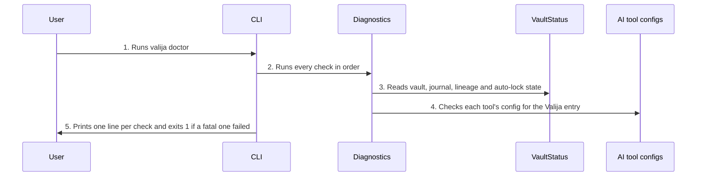

<!-- Generated by tools/living-docs — do not edit. Run `npm run docs`. -->

[← Guide](../README.md)

# Check my setup

*Theme: Health and devices*

## Who

The user, when something does not work, after an upgrade, or after a fork notice.

## Why

One command answers "is my Valija healthy?": the runtime, the encryption module, the keychain, the
vault, sync safety, lineage, auto-lock, and whether each AI tool is connected.

## Business rules

- Checks, in order: Node version, the SQLCipher native module, an OS keychain round-trip, the vault
  status, the journal mode, sync safety (sidecars, conflicted copies, leftover backups, cloud
  folder), lineage, auto-lock, and each supported AI tool's config.
- Some failures are fatal (for example an unsupported Node or a missing SQLCipher module); the
  terminal command then exits with an error status.
- The terminal and the desktop app run the same checks and reach the same verdicts.
- The desktop app runs the checks only when the user asks, and can copy a report built from the rows
  already on screen, without running the keychain probe a second time.
- Checks never read or change context.

## What can go wrong

- The vault status cannot be read; the vault row shows the error code ([`STORAGE_ERROR`](../reference/errors.md#err-storage-error)).
- A fatal check fails; the command exits with status 1.

## How it works

### Entry points

- CLI: [`valija doctor`](../reference/cli.md#cli-doctor)
- Desktop: [`diagnostics:run`](../reference/ipc.md#ipc-diagnostics-run), [`diagnostics:copyReport`](../reference/ipc.md#ipc-diagnostics-copyreport)

### Sequence

### Steps

1. **User → CLI:** Runs `valija doctor` — [`doctorCommand`](../../../src/delivery/cli/doctor.ts)
2. **CLI → Diagnostics:** Runs every check in order — [`runDiagnostics`](../../../src/delivery/diagnostics.ts)
3. **Diagnostics → VaultStatus:** Reads vault, journal, lineage and auto-lock state — [`VaultStatus`](../../../src/vault/application/use-cases/vault-status.use-case.ts)
4. **Diagnostics → AI tool configs:** Checks each tool's config for the Valija entry — [`clientConfigPath`](../../../src/delivery/cli/installer.ts)
5. **CLI → User:** Prints one line per check and exits 1 if a fatal one failed

## Errors

- [`STORAGE_ERROR`](../reference/errors.md#err-storage-error) — the vault files could not be read.
- With no vault yet, the vault row reads "not initialized" and suggests `valija init` (no error code).
