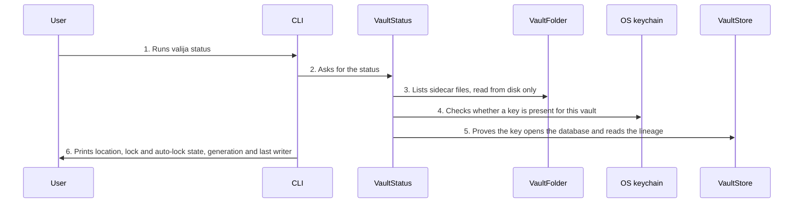

<!-- Generated by living-docs — do not edit. Run `npm run docs`. -->

[← Guide](../README.md)

# Check vault status

*Theme: Vault lifecycle*

## Who

The vault owner, wanting to know whether the vault exists, is unlocked, and is safe to sync.

## Why

One glance answers "can my AI tools use the vault right now?" and "is it safe to switch devices?",
without opening or changing any context.

## Business rules

- Status never reads or returns context items.
- A key in the keychain that no longer opens the vault counts as locked.
- Auto-lock state (timeout, idle time, expired) is reported but never acted on here.
- The desktop app reads the sync-safety half separately: conflicted copies, leftover backups,
  whether the folder looks cloud-synced, and where this device keeps its own state.

## What can go wrong

- There is no vault: status reports "not initialized" instead of failing.
- The vault header is unreadable ([`STORAGE_ERROR`](../reference/errors.md#err-storage-error)).

## How it works

### Entry points

- CLI: [`valija status`](../reference/cli.md#cli-status)
- Desktop: [`vault:status`](../reference/ipc.md#ipc-vault-status) and [`sync:status`](../reference/ipc.md#ipc-sync-status)

### Sequence

### Steps

1. **User → CLI:** Runs `valija status` — [`statusCommand`](../../../src/delivery/cli/vault-commands.ts)
2. **CLI → VaultStatus:** Asks for the status — [`VaultStatus`](../../../src/vault/application/use-cases/vault-status.use-case.ts)
3. **VaultStatus → VaultFolder:** Lists sidecar files, read from disk only — [`FileVaultFolder`](../../../src/vault/infra/file-vault-folder.ts)
4. **VaultStatus → OS keychain:** Checks whether a key is present for this vault
5. **VaultStatus → VaultStore:** Proves the key opens the database and reads the lineage
6. **CLI → User:** Prints location, lock and auto-lock state, generation and last writer

## Errors

- [`STORAGE_ERROR`](../reference/errors.md#err-storage-error) — the vault header could not be read.
