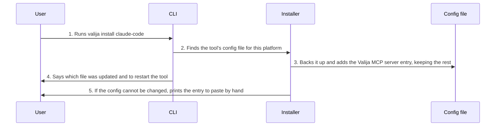

<!-- Generated by living-docs — do not edit. Run `npm run docs`. -->

[← Guide](../README.md)

# Connect an AI tool

*Theme: Connecting AI tools*

## Who

The user, once after creating the vault, for each AI tool they want to give access to their
context (Claude Code, Claude Desktop, Cursor).

## Why

An AI tool can only use Valija once its configuration knows how to start Valija's MCP server.
Connecting writes that entry for the user.

## Business rules

- The entry added to the tool's config runs `npx -y valija mcp`. Everything else in the config is
  preserved.
- An existing config is backed up before it is changed. A config that is not a JSON object is never
  overwritten; the user gets a snippet to paste by hand instead.
- The desktop app also writes which vault folder the tool should use, and shows, per tool, whether
  it is connected and to which vault. It also checks that Node and npm can run, because the AI tool
  needs them to start the server.
- The tool must be restarted to pick up the change.

## What can go wrong

- The client name is unknown; the command lists the supported ones.
- The config cannot be updated automatically (for example invalid JSON); manual instructions are shown.
- Node or npm is missing, so the AI tool would not be able to start the server.

## How it works

### Entry points

- CLI: [`valija install`](../reference/cli.md#cli-install)
- Desktop: [`tools:status`](../reference/ipc.md#ipc-tools-status), [`tools:connect`](../reference/ipc.md#ipc-tools-connect), [`tools:nodeStatus`](../reference/ipc.md#ipc-tools-nodestatus)

### Sequence

### Steps

1. **User → CLI:** Runs `valija install claude-code` — [`valija install`](../reference/cli.md#cli-install)
2. **CLI → Installer:** Finds the tool's config file for this platform — [`clientConfigPath`](../../../src/delivery/cli/installer.ts)
3. **Installer → Config file:** Backs it up and adds the Valija MCP server entry, keeping the rest — [`installIntoClient`](../../../src/delivery/cli/installer.ts)
4. **CLI → User:** Says which file was updated and to restart the tool
5. **Installer → User:** If the config cannot be changed, prints the entry to paste by hand — [`manualInstructions`](../../../src/delivery/cli/installer.ts)

## Errors

- No Valija error code: problems are reported as a message and manual instructions.
