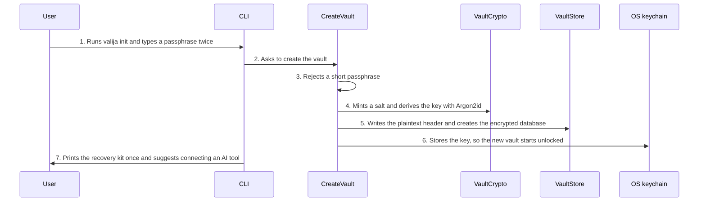

<!-- Generated by living-docs — do not edit. Run `npm run docs`. -->

[← Guide](../README.md)

# Create a vault

*Theme: Vault lifecycle*

## Who

A developer setting Valija up for the first time on a machine, from the terminal or the desktop app.

## Why

To get an encrypted place for AI context that only their passphrase (or their recovery kit) can
open. Everything else in Valija needs a vault first.

## Business rules

- There is one vault per machine (per vault folder); creating a second one is refused.
- The passphrase must be at least 8 characters. It is never trimmed: spaces count.
- The vault key is derived from the passphrase with Argon2id and a random salt; only the salt and
  the cost parameters are written in plain text, never the key.
- The raw key is shown exactly once, as a printable **recovery kit**. Valija never stores it. Losing
  both the passphrase and the kit means the data is gone; there is no reset.
- A new vault starts **unlocked**, and its idle auto-lock clock starts at once.

## What can go wrong

- A vault already exists in the folder ([`VAULT_ALREADY_EXISTS`](../reference/errors.md#err-vault-already-exists)).
- The passphrase is too short ([`WEAK_PASSPHRASE`](../reference/errors.md#err-weak-passphrase)).
- In the terminal, the two passphrase entries do not match; nothing is created.
- The database or header cannot be written ([`STORAGE_ERROR`](../reference/errors.md#err-storage-error)).

## How it works

### Entry points

- CLI: [`valija init`](../reference/cli.md#cli-init)
- Desktop: [`vault:init`](../reference/ipc.md#ipc-vault-init), then [`vault:readRecoveryKit`](../reference/ipc.md#ipc-vault-readrecoverykit) to show the kit once

### Sequence

### Steps

1. **User → CLI:** Runs `valija init` and types a passphrase twice — [`initCommand`](../../../src/delivery/cli/vault-commands.ts)
2. **CLI → CreateVault:** Asks to create the vault — [`CreateVault`](../../../src/vault/application/use-cases/create-vault.use-case.ts)
3. **CreateVault → CreateVault:** Rejects a short passphrase — [`parsePassphrase`](../../../src/vault/domain/values/passphrase.ts)
4. **CreateVault → VaultCrypto:** Mints a salt and derives the key with Argon2id — [`Argon2VaultCrypto`](../../../src/vault/infra/argon2.ts)
5. **CreateVault → VaultStore:** Writes the plaintext header and creates the encrypted database — [`FileVaultStore`](../../../src/vault/infra/file-vault-store.ts)
6. **CreateVault → OS keychain:** Stores the key, so the new vault starts unlocked — [`OsKeychain`](../../../src/vault/infra/keyring.ts)
7. **CLI → User:** Prints the recovery kit once and suggests connecting an AI tool — [`renderRecoveryKit`](../../../src/vault/infra/recovery-kit.ts)

## Errors

- [`VAULT_ALREADY_EXISTS`](../reference/errors.md#err-vault-already-exists) — a vault header is already in the folder.
- [`WEAK_PASSPHRASE`](../reference/errors.md#err-weak-passphrase) — the passphrase is shorter than the minimum.
- [`STORAGE_ERROR`](../reference/errors.md#err-storage-error) — the vault files could not be created.
