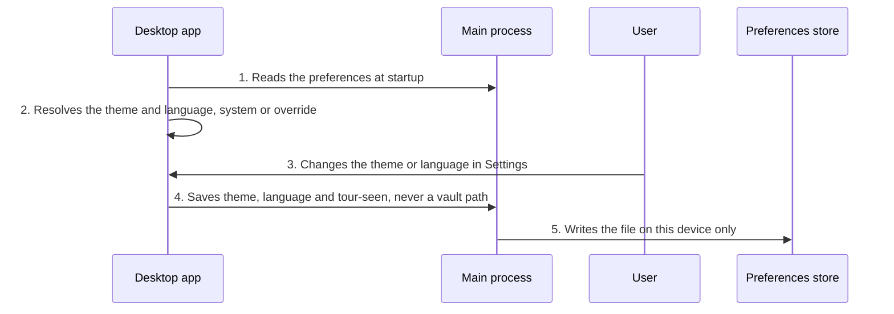

<!-- Generated by tools/living-docs — do not edit. Run `npm run docs`. -->

[← Guide](../README.md)

# Desktop preferences

*Theme: Desktop app*

## Who

A desktop-app user adjusting how the app looks and speaks, or replaying the welcome tour.

## Why

The app follows the operating system's theme and language by default; the user can override both
and have the choice remembered on this device.

## Business rules

- Preferences are device-local UI state, never vault content, keys or configuration.
- Exactly four values: theme, language, whether the welcome tour was seen, and the vault folder
  the app remembers.
- Theme and language each follow the system unless overridden. Any Spanish locale maps to the one
  neutral Spanish catalog; everything else falls back to English.
- Saving preferences can never change the vault folder; only the move or switch flow sets it.
- The welcome tour plays once per installation; skipping it counts as seen. It can be replayed from
  Settings.
- Settings open even while the vault is locked.

## What can go wrong

- The preferences file is missing or damaged; the app starts from the defaults.

## How it works

### Entry points

- CLI: none — desktop-only UI state (see the parity table)
- Desktop: [`preferences:read`](../reference/ipc.md#ipc-preferences-read), [`preferences:write`](../reference/ipc.md#ipc-preferences-write)

### Sequence

### Steps

1. **Desktop app → Main process:** Reads the preferences at startup — [`preferences:read`](../reference/ipc.md#ipc-preferences-read)
2. **Desktop app → Desktop app:** Resolves the theme and language, system or override — [`ThemeProvider`](../../../desktop/src/renderer/state/theme-context.tsx)
3. **User → Desktop app:** Changes the theme or language in Settings — [`openSettings`](../../../desktop/src/renderer/state/overlay-nav.ts)
4. **Desktop app → Main process:** Saves theme, language and tour-seen, never a vault path — [`preferences:write`](../reference/ipc.md#ipc-preferences-write)
5. **Main process → Preferences store:** Writes the file on this device only — [`AppPreferencesStore`](../../../desktop/src/main/application/ports/app-preferences.ts)

## Errors

- No Valija error code: preferences fall back to their defaults.
