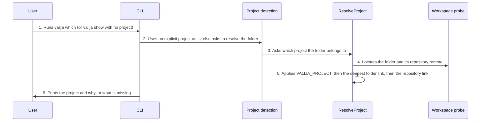

<!-- Generated by tools/living-docs — do not edit. Run `npm run docs`. -->

[← Guide](../README.md)

# Detect the project from the working folder

*Theme: Working with context*

## Who

The user running `valija show` or `valija export` without a project, and AI tools calling the MCP
tools without one.

## Why

So that the project a folder is linked to is used automatically, while a project named
explicitly always wins.

## Business rules

- An explicitly given project is always used as is; detection only runs when it is omitted.
- Detection order: the `VALIJA_PROJECT` environment variable, then the deepest linked folder that
  contains the working folder, then the linked repository the folder belongs to.
- The CLI detects from its current folder (or `--dir` for `valija which`); the MCP server from the
  folders the AI client declares as roots, else from where it was started.
- If several workspace folders resolve to different projects, nothing is guessed. If none
  resolves, the user (or the AI, by asking the user) must name the project. Detection never
  creates a project and never runs `git`.
- MCP responses say only how a project was detected (linked folder, linked repository or
  `VALIJA_PROJECT`), never a path or a remote.
- `valija which` and the desktop inspect panel show what a folder resolves to and why.

## What can go wrong

- The vault is locked ([`VAULT_LOCKED`](../reference/errors.md#err-vault-locked)).
- No project is linked to the folder ([`PROJECT_NOT_DETECTED`](../reference/errors.md#err-project-not-detected)).
- The workspace folders are linked to different projects ([`PROJECT_AMBIGUOUS`](../reference/errors.md#err-project-ambiguous)).
- `VALIJA_PROJECT` is not a valid project name ([`INVALID_PROJECT_NAME`](../reference/errors.md#err-invalid-project-name)).
- The folder is not usable ([`INVALID_WORKSPACE_PATH`](../reference/errors.md#err-invalid-workspace-path)).

## How it works

### Entry points

- CLI: [`valija which`](../reference/cli.md#cli-which) (and `show`/`export` without a project)
- Desktop: [`bindings:inspect`](../reference/ipc.md#ipc-bindings-inspect) (choose a folder on the project screen to see what it resolves to)
- MCP: the project argument of [`get_context`](../reference/mcp.md#mcp-get-context), [`save_context`](../reference/mcp.md#mcp-save-context) and [`save_handoff`](../reference/mcp.md#mcp-save-handoff) is optional

### Sequence

### Steps

1. **User → CLI:** Runs `valija which` (or `valija show` with no project) — [`whichCommand`](../../../src/delivery/cli/binding-commands.ts)
2. **CLI → Project detection:** Uses an explicit project as is, else asks to resolve the folder — [`chooseProject`](../../../src/delivery/project-detection.ts)
3. **Project detection → ResolveProject:** Asks which project the folder belongs to — [`ResolveProject`](../../../src/context/application/use-cases/resolve-project.use-case.ts)
4. **ResolveProject → Workspace probe:** Locates the folder and its repository remote — [`FileWorkspaceProbe`](../../../src/context/infra/file-workspace-probe.ts)
5. **ResolveProject → ResolveProject:** Applies `VALIJA_PROJECT`, then the deepest folder link, then the repository link — [`resolveFromBindings`](../../../src/context/domain/services/project-resolution.ts)
6. **CLI → User:** Prints the project and why, or what is missing

## Errors

- [`VAULT_LOCKED`](../reference/errors.md#err-vault-locked) — unlock the vault first.
- [`PROJECT_NOT_DETECTED`](../reference/errors.md#err-project-not-detected) — pass a project name, or link this folder with `valija link`.
- [`PROJECT_AMBIGUOUS`](../reference/errors.md#err-project-ambiguous) — name the project; the workspace's folders disagree.
- [`INVALID_PROJECT_NAME`](../reference/errors.md#err-invalid-project-name) — `VALIJA_PROJECT` is not a valid project slug.
- [`INVALID_WORKSPACE_PATH`](../reference/errors.md#err-invalid-workspace-path) — the folder does not exist or cannot be read.
