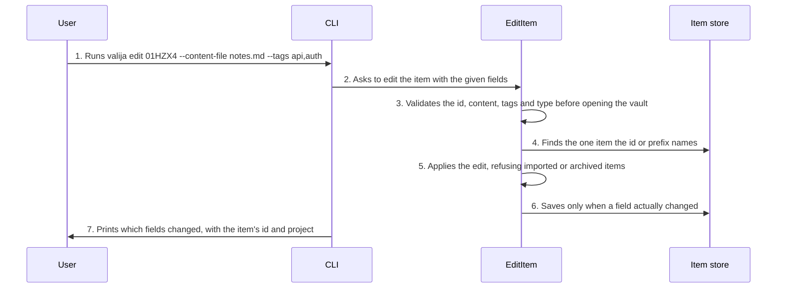

<!-- Generated by tools/living-docs — do not edit. Run `npm run docs`. -->

[← Guide](../README.md)

# Edit an item

*Theme: Working with context*

## Who

The user, correcting or refining something an AI tool saved.

## Why

To fix an item in place — its wording, tags or type — so the vault keeps one accurate item instead
of a wrong one and a correction.

## Business rules

- An item is addressed by its full id or a unique prefix of at least 6 characters.
- Content, tags and type can be changed; each field left out stays as it is, and new tags replace
  the old list (an empty list clears it). The same rules as saving apply: 32 KB, 10 tags, no
  `imported` type.
- The item keeps its id and creation date; its update date is stamped and search is re-indexed.
- Imported and archived items cannot be edited.
- The CLI reads new content from a file or standard input, never an editor; the desktop app edits
  in a dialog and sends only the fields that changed.
- An edit that changes nothing writes nothing.
- New content that looks like it contains a secret is refused, naming the kind and line, never the
  secret. The user can save it anyway: `--allow-secrets` in the CLI, **Save anyway** in the
  desktop dialog.

## What can go wrong

- The vault is locked ([`VAULT_LOCKED`](../reference/errors.md#err-vault-locked)).
- No field to change was given ([`NOTHING_TO_EDIT`](../reference/errors.md#err-nothing-to-edit)).
- The new content looks like it contains a secret ([`POSSIBLE_SECRET`](../reference/errors.md#err-possible-secret)).
- The id is malformed, matches nothing or matches several items ([`INVALID_ITEM_ID`](../reference/errors.md#err-invalid-item-id),
  [`ITEM_NOT_FOUND`](../reference/errors.md#err-item-not-found), [`ITEM_ID_AMBIGUOUS`](../reference/errors.md#err-item-id-ambiguous)).
- The item is imported or archived ([`ITEM_NOT_CURATABLE`](../reference/errors.md#err-item-not-curatable), [`ITEM_ARCHIVED`](../reference/errors.md#err-item-archived)).
- The new content, tags or type are not valid ([`CONTENT_EMPTY`](../reference/errors.md#err-content-empty), [`CONTENT_TOO_LARGE`](../reference/errors.md#err-content-too-large),
  [`INVALID_TAG`](../reference/errors.md#err-invalid-tag), [`TOO_MANY_TAGS`](../reference/errors.md#err-too-many-tags), [`INVALID_ITEM_TYPE`](../reference/errors.md#err-invalid-item-type)).

## How it works

### Entry points

- CLI: [`valija edit`](../reference/cli.md#cli-edit)
- Desktop: [`content:edit`](../reference/ipc.md#ipc-content-edit) (Edit on each item card opens a dialog)

### Sequence

### Steps

1. **User → CLI:** Runs `valija edit 01HZX4 --content-file notes.md --tags api,auth` — [`editCommand`](../../../src/delivery/cli/curation-commands.ts)
2. **CLI → EditItem:** Asks to edit the item with the given fields — [`EditItem`](../../../src/context/application/use-cases/edit-item.use-case.ts)
3. **EditItem → EditItem:** Validates the id, content, tags and type before opening the vault — [`parseItemReference`](../../../src/context/domain/values/item-id.ts)
4. **EditItem → Item store:** Finds the one item the id or prefix names — [`findItemByReference`](../../../src/context/application/services/item-curation-steps.ts)
5. **EditItem → EditItem:** Applies the edit, refusing imported or archived items — [`applyEdit`](../../../src/context/domain/services/item-curation.ts)
6. **EditItem → Item store:** Saves only when a field actually changed — [`saveIfChanged`](../../../src/context/application/services/item-curation-steps.ts)
7. **CLI → User:** Prints which fields changed, with the item's id and project

## Errors

- [`VAULT_LOCKED`](../reference/errors.md#err-vault-locked) — unlock the vault first.
- [`NOTHING_TO_EDIT`](../reference/errors.md#err-nothing-to-edit) — pass at least one of content, tags or type.
- [`INVALID_ITEM_ID`](../reference/errors.md#err-invalid-item-id) / [`ITEM_NOT_FOUND`](../reference/errors.md#err-item-not-found) / [`ITEM_ID_AMBIGUOUS`](../reference/errors.md#err-item-id-ambiguous) — the id does not name exactly one item.
- [`ITEM_NOT_CURATABLE`](../reference/errors.md#err-item-not-curatable) — imported items cannot be edited.
- [`ITEM_ARCHIVED`](../reference/errors.md#err-item-archived) — unarchive the item before editing it.
- [`CONTENT_EMPTY`](../reference/errors.md#err-content-empty) / [`CONTENT_TOO_LARGE`](../reference/errors.md#err-content-too-large) — the new content is empty or over 32 KB.
- [`INVALID_TAG`](../reference/errors.md#err-invalid-tag) / [`TOO_MANY_TAGS`](../reference/errors.md#err-too-many-tags) — a tag is malformed, or there are too many.
- [`INVALID_ITEM_TYPE`](../reference/errors.md#err-invalid-item-type) — the type is not one that can be saved.
- [`POSSIBLE_SECRET`](../reference/errors.md#err-possible-secret) — remove the secret, or save anyway with `--allow-secrets`.
