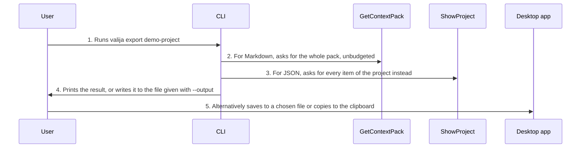

<!-- Generated by living-docs — do not edit. Run `npm run docs`. -->

[← Guide](../README.md)

# Export a project

*Theme: Working with context*

## Who

The user, wanting a project's context outside Valija: to read it, share it, paste it into a tool
without MCP, or keep a copy.

## Why

Context in Valija is never locked in. A project can always be taken out as readable Markdown or as
structured JSON.

## Business rules

- Markdown export is the project's whole context pack, without a token budget.
- JSON export lists every item of the project (including imported ones), with all its fields.
- The terminal prints to the screen or writes to a file (`--output`); the desktop app saves to a
  file chosen in a native dialog, or copies the pack to the clipboard.
- Exporting only reads; it never changes the vault.

## What can go wrong

- The vault is locked ([`VAULT_LOCKED`](../reference/errors.md#err-vault-locked)).
- The project does not exist ([`PROJECT_NOT_FOUND`](../reference/errors.md#err-project-not-found)).
- The user cancels the save dialog in the desktop app; nothing is written.

## How it works

### Entry points

- CLI: [`valija export`](../reference/cli.md#cli-export) (`--json`, `--output`)
- Desktop: [`content:export`](../reference/ipc.md#ipc-content-export), [`content:copy`](../reference/ipc.md#ipc-content-copy)

### Sequence

### Steps

1. **User → CLI:** Runs `valija export demo-project` — [`exportCommand`](../../../src/delivery/cli/content-commands.ts)
2. **CLI → GetContextPack:** For Markdown, asks for the whole pack, unbudgeted — [`exportProjectMarkdown`](../../../src/delivery/context-pack-export.ts)
3. **CLI → ShowProject:** For JSON, asks for every item of the project instead — [`exportProjectJson`](../../../src/delivery/context-pack-export.ts)
4. **CLI → User:** Prints the result, or writes it to the file given with `--output`
5. **User → Desktop app:** Alternatively saves to a chosen file or copies to the clipboard — [`content:export`](../reference/ipc.md#ipc-content-export)

## Errors

- [`VAULT_LOCKED`](../reference/errors.md#err-vault-locked) — unlock the vault first.
- [`PROJECT_NOT_FOUND`](../reference/errors.md#err-project-not-found) — there is no project with that name.
