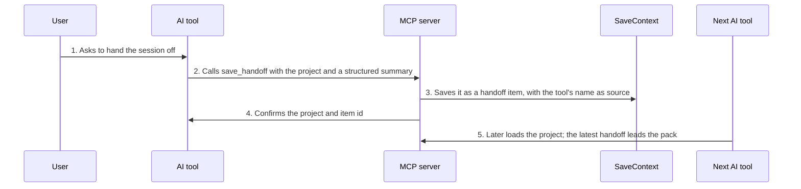

<!-- Generated by living-docs — do not edit. Run `npm run docs`. -->

[← Guide](../README.md)

# Hand off a conversation to another tool

*Theme: Working with context*

## Who

An AI tool, when the user wants to continue the current work in another tool or a new session.

## Why

To package "where we are" (goal, what was done, blockers, the exact next step, relevant files) so
the next tool can pick up seamlessly instead of starting from zero.

## Business rules

- A handoff is a context item of type `handoff` in the project.
- Only the **latest** handoff is included in a project's context pack, right after pinned items.
- It follows every rule of a normal save: unlocked vault, project created on the fly, 32 KB cap.

## What can go wrong

- The vault is locked ([`VAULT_LOCKED`](../reference/errors.md#err-vault-locked)).
- Bad project name or content ([`INVALID_PROJECT_NAME`](../reference/errors.md#err-invalid-project-name), [`CONTENT_EMPTY`](../reference/errors.md#err-content-empty), [`CONTENT_TOO_LARGE`](../reference/errors.md#err-content-too-large)).

## How it works

### Entry points

- CLI: none — handoffs are written by AI tools through MCP
- Desktop: none — the desktop app shows handoffs in the project and the pack preview
- MCP: [`save_handoff`](../reference/mcp.md#mcp-save-handoff)

### Sequence

### Steps

1. **User → AI tool:** Asks to hand the session off
2. **AI tool → MCP server:** Calls `save_handoff` with the project and a structured summary — [`save_handoff`](../reference/mcp.md#mcp-save-handoff)
3. **MCP server → SaveContext:** Saves it as a `handoff` item, with the tool's name as source — [`SaveContext`](../../../src/context/application/use-cases/save-context.use-case.ts)
4. **MCP server → AI tool:** Confirms the project and item id
5. **Next AI tool → MCP server:** Later loads the project; the latest handoff leads the pack — [`get_context`](../reference/mcp.md#mcp-get-context)

## Errors

- [`VAULT_LOCKED`](../reference/errors.md#err-vault-locked) — unlock the vault first.
- [`INVALID_PROJECT_NAME`](../reference/errors.md#err-invalid-project-name) — the project slug is not valid.
- [`CONTENT_EMPTY`](../reference/errors.md#err-content-empty) / [`CONTENT_TOO_LARGE`](../reference/errors.md#err-content-too-large) — the summary is empty or over 32 KB.
