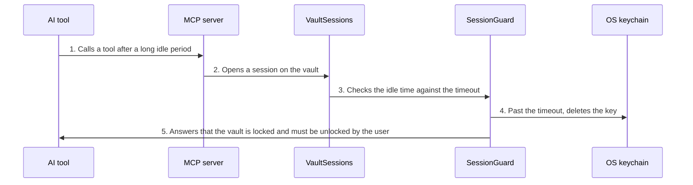

<!-- Generated by living-docs — do not edit. Run `npm run docs`. -->

[← Guide](../README.md)

# Idle auto-lock

*Theme: Vault lifecycle*

## Who

Nobody triggers it on purpose: it protects a user who forgot to lock the vault.

## Why

An unlocked vault left alone for a long time is a risk. After a period of inactivity the vault
locks itself, so a forgotten session does not stay open forever.

## Business rules

- The default timeout is 15 minutes of inactivity. `VALIJA_AUTOLOCK_MINUTES` changes it; `0` or
  `off` disables it. A malformed value falls back to the default instead of blocking startup.
- There is no background process. The check happens lazily, the next time anything opens the vault.
- When the timeout has passed, the key is really deleted from the keychain (a genuine lock, not a
  refusal), and the caller gets the same "vault is locked" error as any locked vault.
- Every successful use refreshes the idle clock.

## What can go wrong

- An AI tool or command finds the vault locked ([`VAULT_LOCKED`](../reference/errors.md#err-vault-locked)) and asks the user to unlock.

## How it works

### Entry points

- CLI: none — it happens on the next command after the timeout
- Desktop: none — the next IPC call that opens the vault refuses

### Sequence

### Steps

1. **AI tool → MCP server:** Calls a tool after a long idle period — [`buildMcpServer`](../../../src/delivery/mcp/server.ts)
2. **MCP server → VaultSessions:** Opens a session on the vault — [`SqliteVaultSessions`](../../../src/context/infra/vault-sessions.ts)
3. **VaultSessions → SessionGuard:** Checks the idle time against the timeout — [`SessionGuard`](../../../src/vault/application/policies/session-guard.ts)
4. **SessionGuard → OS keychain:** Past the timeout, deletes the key — [`isIdleExpired`](../../../src/vault/domain/values/auto-lock-ttl.ts)
5. **SessionGuard → AI tool:** Answers that the vault is locked and must be unlocked by the user

## Errors

- [`VAULT_LOCKED`](../reference/errors.md#err-vault-locked) — the vault locked itself after the idle timeout.
