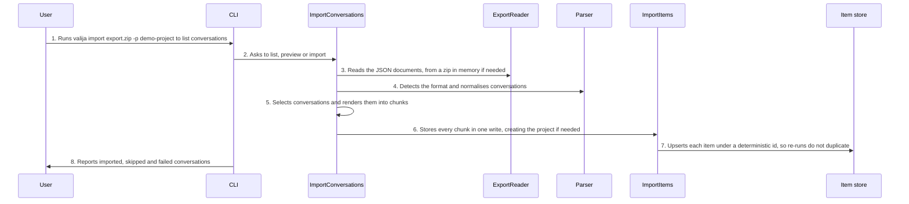

<!-- Generated by tools/living-docs — do not edit. Run `npm run docs`. -->

[← Guide](../README.md)

# Import chat history

*Theme: Bringing history in*

## Who

A user whose real history lives in ChatGPT or Claude.ai and who wants it next to their saved
context, without retyping anything.

## Why

A fresh vault is empty. Importing the official data export turns past conversations into a
searchable archive inside the encrypted vault.

## Business rules

- Supported sources: ChatGPT and Claude.ai data exports (`.zip` or `.json`), and Valija's own
  versioned generic format for anything else. The format is detected from the content, or forced.
- **List first:** without a selection, nothing is written; the user sees a numbered list of
  conversations (date, size, estimated items, title) and then picks.
- Selection: all, by index (`1,3-5`), by title text, or since a date. A dry run goes through the
  whole pipeline and writes nothing.
- Each conversation becomes one or more `imported` items of at most 28 KB, each headed by where it
  came from (source, title, date, part n of m). Original dates are kept.
- Re-importing the same export into the same project creates no duplicates.
- Imported items are **searchable and browsable, but never part of a context pack**: an archive
  pulled on demand, not context pushed into every session.
- One bad conversation is reported and skipped; it never aborts the import. The whole import is one
  write to the vault.
- Zip files are read in memory with caps that stop decompression bombs; nothing is extracted to disk.
- In the desktop app the file is chosen in a native dialog and passed as an opaque handle.

## What can go wrong

- The file cannot be read ([`UNREADABLE_FILE`](../reference/errors.md#err-unreadable-file)) or the archive is damaged or oversized ([`CORRUPT_ARCHIVE`](../reference/errors.md#err-corrupt-archive)).
- The format is not recognised ([`UNSUPPORTED_SOURCE`](../reference/errors.md#err-unsupported-source)), the file is not a valid export
  ([`MALFORMED_EXPORT`](../reference/errors.md#err-malformed-export)), it is empty ([`EMPTY_EXPORT`](../reference/errors.md#err-empty-export)), or the generic format has an
  unknown version ([`UNSUPPORTED_GENERIC_VERSION`](../reference/errors.md#err-unsupported-generic-version)).
- The selection is invalid ([`INVALID_SELECTION`](../reference/errors.md#err-invalid-selection)) or matches nothing ([`NO_CONVERSATIONS_SELECTED`](../reference/errors.md#err-no-conversations-selected)).
- The vault is locked ([`VAULT_LOCKED`](../reference/errors.md#err-vault-locked)).

## How it works

### Entry points

- CLI: [`valija import`](../reference/cli.md#cli-import) (`--list`, `--pick`, `--query`, `--since`, `--all`, `--dry-run`, `--from`)
- Desktop: [`dialog:chooseImportFile`](../reference/ipc.md#ipc-dialog-chooseimportfile), [`import:list`](../reference/ipc.md#ipc-import-list), [`import:preview`](../reference/ipc.md#ipc-import-preview), [`import:run`](../reference/ipc.md#ipc-import-run)

### Sequence

### Steps

1. **User → CLI:** Runs `valija import export.zip -p demo-project` to list conversations — [`importCommand`](../../../src/delivery/cli/import-command.ts)
2. **CLI → ImportConversations:** Asks to list, preview or import — [`ImportConversations`](../../../src/importers/application/use-cases/import-conversations.use-case.ts)
3. **ImportConversations → ExportReader:** Reads the JSON documents, from a zip in memory if needed — [`FileExportReader`](../../../src/importers/infra/file-export-reader.ts)
4. **ImportConversations → Parser:** Detects the format and normalises conversations — [`ChatgptParser`](../../../src/importers/infra/parsers/chatgpt-parser.ts)
5. **ImportConversations → ImportConversations:** Selects conversations and renders them into chunks — [`renderConversationChunks`](../../../src/importers/domain/services/chunk-render.ts)
6. **ImportConversations → ImportItems:** Stores every chunk in one write, creating the project if needed — [`ImportItems`](../../../src/context/application/use-cases/import-items.use-case.ts)
7. **ImportItems → Item store:** Upserts each item under a deterministic id, so re-runs do not duplicate — [`createImportedContextItem`](../../../src/context/domain/entities/context-item.ts)
8. **CLI → User:** Reports imported, skipped and failed conversations

## Errors

- [`UNREADABLE_FILE`](../reference/errors.md#err-unreadable-file) — the file could not be read.
- [`CORRUPT_ARCHIVE`](../reference/errors.md#err-corrupt-archive) — the zip is damaged or exceeds the decompression caps.
- [`UNSUPPORTED_SOURCE`](../reference/errors.md#err-unsupported-source) — the format could not be detected; force it with `--from`.
- [`MALFORMED_EXPORT`](../reference/errors.md#err-malformed-export) — the file is not a valid export of that format.
- [`EMPTY_EXPORT`](../reference/errors.md#err-empty-export) — the export holds no conversations.
- [`UNSUPPORTED_GENERIC_VERSION`](../reference/errors.md#err-unsupported-generic-version) — the generic envelope's version is unknown.
- [`INVALID_SELECTION`](../reference/errors.md#err-invalid-selection) — the pick, query or date is malformed.
- [`NO_CONVERSATIONS_SELECTED`](../reference/errors.md#err-no-conversations-selected) — nothing matches the selection.
- [`VAULT_LOCKED`](../reference/errors.md#err-vault-locked) — unlock the vault first.
