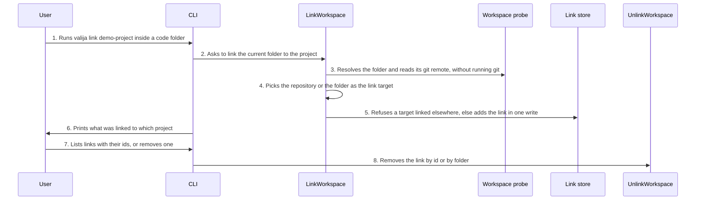

<!-- Generated by tools/living-docs — do not edit. Run `npm run docs`. -->

[← Guide](../README.md)

# Link a folder or repository to a project

*Theme: Working with context*

## Who

The user, telling valija once which project a code folder or git repository belongs to.

## Why

So that commands run in that folder, and AI tools working in it, find the right project without
the user naming it every time.

## Business rules

- A link always points at an **existing** project; linking never creates one.
- By default a folder inside a git repository with a usable remote is linked by its repository
  (normalized `host/owner/repo`, credentials stripped), so every clone on every synced device
  resolves to the same project. Otherwise, or on request (`--by folder`), only the folder (and
  everything under it) is linked.
- The home folder and the filesystem root are too broad to link as a folder.
- A folder or repository can be linked to one project only; linking it again to the same project
  changes nothing.
- Links can be listed (with their ids) and removed by id, or by the folder they apply to.
- Links are user acts: AI tools cannot create or remove them through MCP.

## What can go wrong

- The vault is locked ([`VAULT_LOCKED`](../reference/errors.md#err-vault-locked)).
- The project does not exist ([`PROJECT_NOT_FOUND`](../reference/errors.md#err-project-not-found)).
- The folder is not usable, or too broad to link ([`INVALID_WORKSPACE_PATH`](../reference/errors.md#err-invalid-workspace-path)).
- A repository link was asked for but there is no usable remote ([`NO_GIT_REMOTE`](../reference/errors.md#err-no-git-remote)).
- The folder or repository is already linked to another project ([`BINDING_CONFLICT`](../reference/errors.md#err-binding-conflict)).
- The link to remove does not exist ([`BINDING_NOT_FOUND`](../reference/errors.md#err-binding-not-found)).

## How it works

### Entry points

- CLI: [`valija link`](../reference/cli.md#cli-link), [`valija unlink`](../reference/cli.md#cli-unlink), [`valija links`](../reference/cli.md#cli-links)
- Desktop: [`dialog:chooseProjectFolder`](../reference/ipc.md#ipc-dialog-chooseprojectfolder), [`bindings:link`](../reference/ipc.md#ipc-bindings-link), [`bindings:unlink`](../reference/ipc.md#ipc-bindings-unlink),
  [`bindings:list`](../reference/ipc.md#ipc-bindings-list) (linked folders & repositories on the project screen)

### Sequence

### Steps

1. **User → CLI:** Runs `valija link demo-project` inside a code folder — [`linkCommand`](../../../src/delivery/cli/binding-commands.ts)
2. **CLI → LinkWorkspace:** Asks to link the current folder to the project — [`LinkWorkspace`](../../../src/context/application/use-cases/link-workspace.use-case.ts)
3. **LinkWorkspace → Workspace probe:** Resolves the folder and reads its git remote, without running git — [`FileWorkspaceProbe`](../../../src/context/infra/file-workspace-probe.ts)
4. **LinkWorkspace → LinkWorkspace:** Picks the repository or the folder as the link target — [`chooseLinkTarget`](../../../src/context/domain/services/project-resolution.ts)
5. **LinkWorkspace → Link store:** Refuses a target linked elsewhere, else adds the link in one write — [`SqliteProjectBindingRepository`](../../../src/context/infra/sqlite-project-binding-repository.ts)
6. **CLI → User:** Prints what was linked to which project
7. **User → CLI:** Lists links with their ids, or removes one — [`ListProjectBindings`](../../../src/context/application/use-cases/list-project-bindings.use-case.ts)
8. **CLI → UnlinkWorkspace:** Removes the link by id or by folder — [`UnlinkWorkspace`](../../../src/context/application/use-cases/unlink-workspace.use-case.ts)

## Errors

- [`VAULT_LOCKED`](../reference/errors.md#err-vault-locked) — unlock the vault first.
- [`PROJECT_NOT_FOUND`](../reference/errors.md#err-project-not-found) — create the project first (save context to it, or import into it).
- [`INVALID_WORKSPACE_PATH`](../reference/errors.md#err-invalid-workspace-path) — the folder does not exist, or is the home folder or disk root.
- [`NO_GIT_REMOTE`](../reference/errors.md#err-no-git-remote) — there is no usable remote; link the folder instead.
- [`BINDING_CONFLICT`](../reference/errors.md#err-binding-conflict) — unlink the existing link first.
- [`BINDING_NOT_FOUND`](../reference/errors.md#err-binding-not-found) — no link has that id, or none applies to this folder.
