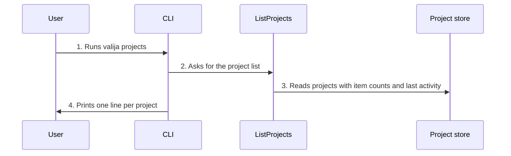

<!-- Generated by tools/living-docs — do not edit. Run `npm run docs`. -->

[← Guide](../README.md)

# List projects

*Theme: Working with context*

## Who

The user, or an AI tool that needs to know which project the user means before saving or loading.

## Why

To see what the vault holds at a glance: every project, how many items it has, and when it was
last active.

## Business rules

- Every project is listed with its item count (archived items excluded) and last activity date.
- Listing only reads; it never changes the vault.

## What can go wrong

- The vault is locked ([`VAULT_LOCKED`](../reference/errors.md#err-vault-locked)).

## How it works

### Entry points

- CLI: [`valija projects`](../reference/cli.md#cli-projects)
- Desktop: [`content:projects`](../reference/ipc.md#ipc-content-projects) (the dashboard)
- MCP: [`list_projects`](../reference/mcp.md#mcp-list-projects)

### Sequence

### Steps

1. **User → CLI:** Runs `valija projects` — [`projectsCommand`](../../../src/delivery/cli/content-commands.ts)
2. **CLI → ListProjects:** Asks for the project list — [`ListProjects`](../../../src/context/application/use-cases/list-projects.use-case.ts)
3. **ListProjects → Project store:** Reads projects with item counts and last activity — [`SqliteProjectRepository`](../../../src/context/infra/project-repo.ts)
4. **CLI → User:** Prints one line per project

## Errors

- [`VAULT_LOCKED`](../reference/errors.md#err-vault-locked) — unlock the vault first.
