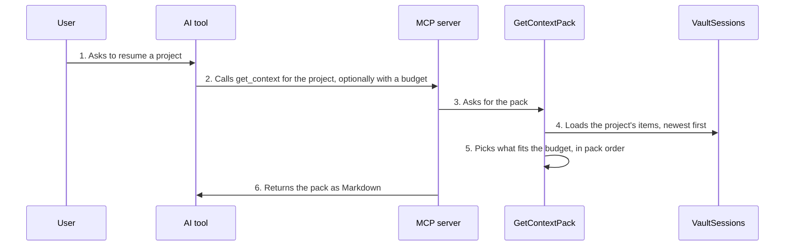

<!-- Generated by living-docs — do not edit. Run `npm run docs`. -->

[← Guide](../README.md)

# Load a project's context pack

*Theme: Working with context*

## Who

An AI tool starting or resuming work on a project, or the user previewing what the AI will see.

## Why

To give the AI the right context at the start of a session (pinned notes, the latest handoff,
decisions, preferences, progress, facts) without the user pasting anything.

## Business rules

- The pack is ordered: **pinned** items first, then the **latest handoff**, then decisions,
  preferences, progress and facts, each newest first. No item appears twice.
- It fits a token budget (4,000 by default, estimated at about 4 characters per token). The newest
  pinned item is always kept; older items are cut first.
- Imported conversations are never part of a pack: they are searchable, not auto-loaded.
- The `load-context` prompt asks the AI to load the pack and summarise where things stand.
- The desktop app shows the whole pack, unbudgeted, as a preview.

## What can go wrong

- The vault is locked ([`VAULT_LOCKED`](../reference/errors.md#err-vault-locked)).
- The project does not exist ([`PROJECT_NOT_FOUND`](../reference/errors.md#err-project-not-found)) or the name is invalid ([`INVALID_PROJECT_NAME`](../reference/errors.md#err-invalid-project-name)).

## How it works

### Entry points

- CLI: [`valija export`](../reference/cli.md#cli-export) prints the same pack, unbudgeted (see the export flow)
- Desktop: [`content:pack`](../reference/ipc.md#ipc-content-pack) (pack preview)
- MCP: [`get_context`](../reference/mcp.md#mcp-get-context), prompt [`load-context`](../reference/mcp.md#prompt-load-context)

### Sequence

### Steps

1. **User → AI tool:** Asks to resume a project — [`load-context`](../reference/mcp.md#prompt-load-context)
2. **AI tool → MCP server:** Calls `get_context` for the project, optionally with a budget — [`get_context`](../reference/mcp.md#mcp-get-context)
3. **MCP server → GetContextPack:** Asks for the pack — [`GetContextPack`](../../../src/context/application/use-cases/get-context-pack.use-case.ts)
4. **GetContextPack → VaultSessions:** Loads the project's items, newest first — [`SqliteContextItemRepository`](../../../src/context/infra/item-repo.ts)
5. **GetContextPack → GetContextPack:** Picks what fits the budget, in pack order — [`assembleContextPack`](../../../src/context/domain/services/context-pack.ts)
6. **MCP server → AI tool:** Returns the pack as Markdown — [`renderContextPackMarkdown`](../../../src/delivery/context-pack-markdown.ts)

## Errors

- [`VAULT_LOCKED`](../reference/errors.md#err-vault-locked) — unlock the vault first.
- [`PROJECT_NOT_FOUND`](../reference/errors.md#err-project-not-found) — there is no project with that name.
- [`INVALID_PROJECT_NAME`](../reference/errors.md#err-invalid-project-name) — the project slug is not valid.
