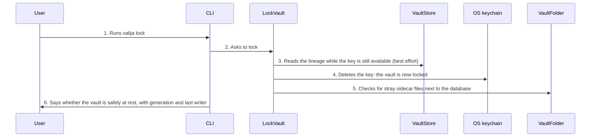

<!-- Generated by living-docs — do not edit. Run `npm run docs`. -->

[← Guide](../README.md)

# Lock the vault

*Theme: Vault lifecycle*

## Who

The vault owner, when they step away or before switching to another device.

## Why

Locking removes the key from the OS keychain, so neither the user's tools nor anything else on the
machine can read the vault until it is unlocked again. It is also the "safe to sync" signal before
opening the vault on another device.

## Business rules

- Locking is always allowed and never loses data.
- The report says whether the vault is a single, settled file on disk. Stray journal files mean it
  is not yet safe for a sync client to upload.
- When it can, the report names the vault's generation and which device wrote last.

## What can go wrong

- There is no vault ([`VAULT_NOT_FOUND`](../reference/errors.md#err-vault-not-found)).
- The vault was already locked; the command says so and does nothing else.
- Stray sidecar files are present; the report warns that the vault is not safely at rest.

## How it works

### Entry points

- CLI: [`valija lock`](../reference/cli.md#cli-lock)
- Desktop: [`vault:lock`](../reference/ipc.md#ipc-vault-lock)

### Sequence

### Steps

1. **User → CLI:** Runs `valija lock` — [`lockCommand`](../../../src/delivery/cli/vault-commands.ts)
2. **CLI → LockVault:** Asks to lock — [`LockVault`](../../../src/vault/application/use-cases/lock-vault.use-case.ts)
3. **LockVault → VaultStore:** Reads the lineage while the key is still available (best effort)
4. **LockVault → OS keychain:** Deletes the key: the vault is now locked — [`KeychainPort`](../../../src/vault/application/ports/keychain.ts)
5. **LockVault → VaultFolder:** Checks for stray sidecar files next to the database — [`FileVaultFolder`](../../../src/vault/infra/file-vault-folder.ts)
6. **CLI → User:** Says whether the vault is safely at rest, with generation and last writer

## Errors

- [`VAULT_NOT_FOUND`](../reference/errors.md#err-vault-not-found) — there is no vault to lock.
