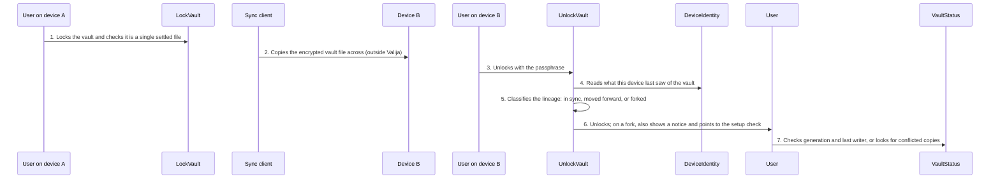

<!-- Generated by living-docs — do not edit. Run `npm run docs`. -->

[← Guide](../README.md)

# Use one vault on several devices

*Theme: Health and devices*

## Who

A developer who works on more than one machine and keeps the vault in a folder their own sync
client replicates.

## Why

To have the same AI context on every machine without any Valija server or account: the encrypted
file travels through the sync client the user already trusts.

## Business rules

- Valija never talks to a server; the sync client moves the encrypted file.
- The ritual is: **lock** on device A, let the sync client finish, **unlock** on device B.
- Every write advances the vault's lineage (a generation counter plus a random write stamp). Each
  device remembers the last lineage it saw.
- On unlock, a lineage that moved forward is adopted silently. If two devices wrote independently
  from the same starting point, that is a **fork**: the vault still unlocks, a notice is shown, and
  nothing is deleted or merged. The sync client may have kept the other version as a "conflicted
  copy" file, which status and the setup check point out.
- Lineage lives only inside the encrypted database; the plaintext header never reveals it.

## What can go wrong

- The user skips the ritual and both devices write: a fork notice on unlock ([`VAULT_FORK_DETECTED`](../reference/errors.md#err-vault-fork-detected)).
- The vault is not settled on disk when the sync client uploads it: lock reports stray sidecar files.

## How it works

### Entry points

- CLI: [`valija lock`](../reference/cli.md#cli-lock), [`valija unlock`](../reference/cli.md#cli-unlock), [`valija status`](../reference/cli.md#cli-status)
- Desktop: [`vault:lock`](../reference/ipc.md#ipc-vault-lock), [`vault:unlock`](../reference/ipc.md#ipc-vault-unlock), [`vault:status`](../reference/ipc.md#ipc-vault-status), [`sync:status`](../reference/ipc.md#ipc-sync-status)

### Sequence

### Steps

1. **User on device A → LockVault:** Locks the vault and checks it is a single settled file — [`LockVault`](../../../src/vault/application/use-cases/lock-vault.use-case.ts)
2. **Sync client → Device B:** Copies the encrypted vault file across (outside Valija)
3. **User on device B → UnlockVault:** Unlocks with the passphrase — [`UnlockVault`](../../../src/vault/application/use-cases/unlock-vault.use-case.ts)
4. **UnlockVault → DeviceIdentity:** Reads what this device last saw of the vault — [`FileDeviceIdentity`](../../../src/vault/infra/file-device-identity.ts)
5. **UnlockVault → UnlockVault:** Classifies the lineage: in sync, moved forward, or forked — [`classifyLineage`](../../../src/vault/domain/services/vault-lineage.ts)
6. **UnlockVault → User:** Unlocks; on a fork, also shows a notice and points to the setup check
7. **User → VaultStatus:** Checks generation and last writer, or looks for conflicted copies — [`VaultStatus`](../../../src/vault/application/use-cases/vault-status.use-case.ts)

## Errors

- [`VAULT_FORK_DETECTED`](../reference/errors.md#err-vault-fork-detected) — two devices wrote independently; nothing was deleted.
- [`VAULT_LOCKED`](../reference/errors.md#err-vault-locked) — a device tried to use the vault before unlocking it.
