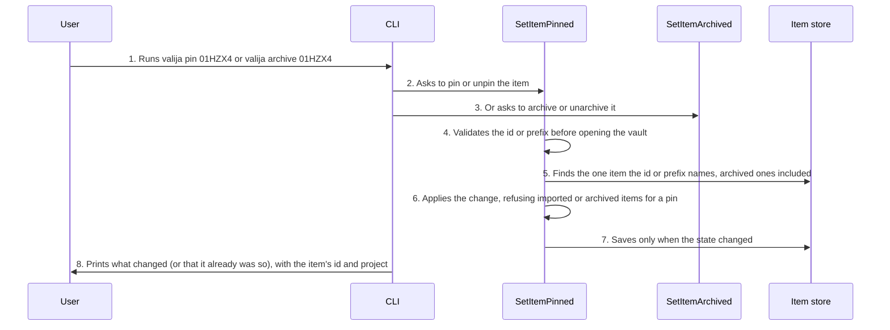

<!-- Generated by tools/living-docs — do not edit. Run `npm run docs`. -->

[← Guide](../README.md)

# Pin or archive an item

*Theme: Working with context*

## Who

The user, tidying a project's memory: keeping what matters on top and retiring what is out of date.

## Why

So the context pack an AI tool loads leads with what the user says matters and leaves out what no
longer holds, without deleting anything.

## Business rules

- An item is addressed by its full id or by a unique prefix of at least 6 characters (the CLI prints
  ids in `valija show`; the desktop app acts on the card itself).
- A pinned item always leads its project's context pack. Imported and archived items cannot be
  pinned.
- Archiving is a soft, reversible removal: the item leaves packs, search and counts but stays in
  the vault, and `unarchive` brings it back. Any item can be archived, imported ones included.
- Pinning an already pinned item, or archiving an already archived one, changes nothing and writes
  nothing.
- AI tools cannot pin or archive through MCP; the only archive a model can cause is a `supersedes`
  on save, which never touches pinned items.

## What can go wrong

- The vault is locked ([`VAULT_LOCKED`](../reference/errors.md#err-vault-locked)).
- The id is malformed or too short, matches nothing, or matches several items
  ([`INVALID_ITEM_ID`](../reference/errors.md#err-invalid-item-id), [`ITEM_NOT_FOUND`](../reference/errors.md#err-item-not-found), [`ITEM_ID_AMBIGUOUS`](../reference/errors.md#err-item-id-ambiguous)).
- The item cannot be pinned because it is imported or archived ([`ITEM_NOT_CURATABLE`](../reference/errors.md#err-item-not-curatable),
  [`ITEM_ARCHIVED`](../reference/errors.md#err-item-archived)).

## How it works

### Entry points

- CLI: [`valija pin`](../reference/cli.md#cli-pin), [`valija unpin`](../reference/cli.md#cli-unpin), [`valija archive`](../reference/cli.md#cli-archive), [`valija unarchive`](../reference/cli.md#cli-unarchive)
- Desktop: [`content:setPinned`](../reference/ipc.md#ipc-content-setpinned), [`content:setArchived`](../reference/ipc.md#ipc-content-setarchived) (Pin, Archive and Undo on each
  item card; **Show archived** lists archived items with Unarchive)

### Sequence

### Steps

1. **User → CLI:** Runs `valija pin 01HZX4` or `valija archive 01HZX4` — [`pinCommand`](../../../src/delivery/cli/curation-commands.ts)
2. **CLI → SetItemPinned:** Asks to pin or unpin the item — [`SetItemPinned`](../../../src/context/application/use-cases/set-item-pinned.use-case.ts)
3. **CLI → SetItemArchived:** Or asks to archive or unarchive it — [`SetItemArchived`](../../../src/context/application/use-cases/set-item-archived.use-case.ts)
4. **SetItemPinned → SetItemPinned:** Validates the id or prefix before opening the vault — [`parseItemReference`](../../../src/context/domain/values/item-id.ts)
5. **SetItemPinned → Item store:** Finds the one item the id or prefix names, archived ones included — [`findItemByReference`](../../../src/context/application/services/item-curation-steps.ts)
6. **SetItemPinned → SetItemPinned:** Applies the change, refusing imported or archived items for a pin — [`setPinned`](../../../src/context/domain/services/item-curation.ts)
7. **SetItemPinned → Item store:** Saves only when the state changed — [`saveIfChanged`](../../../src/context/application/services/item-curation-steps.ts)
8. **CLI → User:** Prints what changed (or that it already was so), with the item's id and project

## Errors

- [`VAULT_LOCKED`](../reference/errors.md#err-vault-locked) — unlock the vault first.
- [`INVALID_ITEM_ID`](../reference/errors.md#err-invalid-item-id) — the id is malformed, or a prefix is shorter than 6 characters.
- [`ITEM_NOT_FOUND`](../reference/errors.md#err-item-not-found) — no item has that id or prefix.
- [`ITEM_ID_AMBIGUOUS`](../reference/errors.md#err-item-id-ambiguous) — the prefix matches several items; type more of the id.
- [`ITEM_NOT_CURATABLE`](../reference/errors.md#err-item-not-curatable) — imported items can only be archived or unarchived.
- [`ITEM_ARCHIVED`](../reference/errors.md#err-item-archived) — unarchive the item before pinning it.
