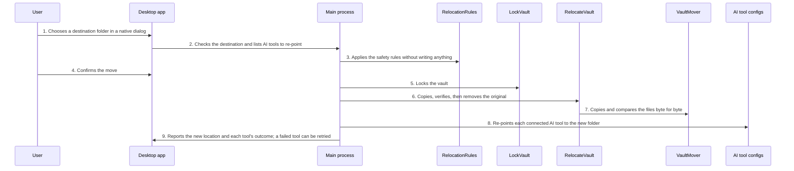

<!-- Generated by living-docs — do not edit. Run `npm run docs`. -->

[← Guide](../README.md)

# Move the vault to another folder

*Theme: Desktop app*

## Who

A desktop-app user who wants the vault somewhere else, typically inside a folder their sync client
already replicates (Dropbox, iCloud Drive, Syncthing…).

## Why

To use one vault on several machines, or simply to keep it in a better place, without exporting
and re-importing anything, and without breaking the AI tools that already use it.

## Business rules

- The vault must be locked first; the move never handles the key.
- The destination is checked before anything is written: it must exist, be writable, hold no vault,
  and not be inside the current vault folder. The current folder must be settled (no conflicted
  copies, leftover backups or sidecar files).
- Files are copied, verified byte for byte, and only then is the original removed. Never "delete,
  then copy".
- If removing the original fails, the copy is discarded so there is never two openable vaults. If
  even that fails, the user is told exactly which folder to delete by hand.
- Connected AI tools are re-pointed to the new location afterwards; one that cannot be re-pointed is
  reported with a snippet to paste.
- The desktop app can also switch to a vault that already exists in another folder.
- Paths never travel from the window to the main process: folders are chosen in a native dialog
  and passed as opaque handles.

## What can go wrong

- The vault is unlocked ([`VAULT_MUST_BE_LOCKED`](../reference/errors.md#err-vault-must-be-locked)).
- The destination already holds a vault ([`RELOCATION_DESTINATION_OCCUPIED`](../reference/errors.md#err-relocation-destination-occupied)), cannot be used
  ([`RELOCATION_DESTINATION_UNUSABLE`](../reference/errors.md#err-relocation-destination-unusable)), or is inside the current folder
  ([`RELOCATION_DESTINATION_NESTED`](../reference/errors.md#err-relocation-destination-nested)).
- The current folder is not settled ([`RELOCATION_SOURCE_UNSETTLED`](../reference/errors.md#err-relocation-source-unsettled)).
- The copy or its verification fails ([`RELOCATION_COPY_FAILED`](../reference/errors.md#err-relocation-copy-failed), [`RELOCATION_VERIFY_FAILED`](../reference/errors.md#err-relocation-verify-failed)).
- Cleanup fails after a failed removal ([`RELOCATION_ROLLBACK_FAILED`](../reference/errors.md#err-relocation-rollback-failed)).

## How it works

### Entry points

- CLI: none — known gap, `valija relocate` is owed to a future advance (see the parity table)
- Desktop: [`dialog:chooseVaultFolder`](../reference/ipc.md#ipc-dialog-choosevaultfolder), [`relocation:preflight`](../reference/ipc.md#ipc-relocation-preflight), [`relocation:move`](../reference/ipc.md#ipc-relocation-move), [`relocation:retryClient`](../reference/ipc.md#ipc-relocation-retryclient), [`relocation:pointAtExisting`](../reference/ipc.md#ipc-relocation-pointatexisting)

### Sequence

### Steps

1. **User → Desktop app:** Chooses a destination folder in a native dialog — [`dialog:chooseVaultFolder`](../reference/ipc.md#ipc-dialog-choosevaultfolder)
2. **Desktop app → Main process:** Checks the destination and lists AI tools to re-point — [`relocation:preflight`](../reference/ipc.md#ipc-relocation-preflight)
3. **Main process → RelocationRules:** Applies the safety rules without writing anything — [`refuseUnsafeRelocation`](../../../src/vault/domain/services/vault-relocation.ts)
4. **User → Desktop app:** Confirms the move — [`relocation:move`](../reference/ipc.md#ipc-relocation-move)
5. **Main process → LockVault:** Locks the vault — [`LockVault`](../../../src/vault/application/use-cases/lock-vault.use-case.ts)
6. **Main process → RelocateVault:** Copies, verifies, then removes the original — [`RelocateVault`](../../../src/vault/application/use-cases/relocate-vault.use-case.ts)
7. **RelocateVault → VaultMover:** Copies and compares the files byte for byte — [`FileVaultMover`](../../../src/vault/infra/file-vault-mover.ts)
8. **Main process → AI tool configs:** Re-points each connected AI tool to the new folder — [`installIntoClient`](../../../src/delivery/cli/installer.ts)
9. **Main process → Desktop app:** Reports the new location and each tool's outcome; a failed tool can be retried — [`relocation:retryClient`](../reference/ipc.md#ipc-relocation-retryclient)

## Errors

- [`VAULT_MUST_BE_LOCKED`](../reference/errors.md#err-vault-must-be-locked) — the vault was still unlocked.
- [`RELOCATION_DESTINATION_OCCUPIED`](../reference/errors.md#err-relocation-destination-occupied) — the destination already holds a vault.
- [`RELOCATION_DESTINATION_UNUSABLE`](../reference/errors.md#err-relocation-destination-unusable) — the destination does not exist or is not writable.
- [`RELOCATION_DESTINATION_NESTED`](../reference/errors.md#err-relocation-destination-nested) — the destination is inside the current vault folder.
- [`RELOCATION_SOURCE_UNSETTLED`](../reference/errors.md#err-relocation-source-unsettled) — the current folder is not settled.
- [`RELOCATION_COPY_FAILED`](../reference/errors.md#err-relocation-copy-failed) — copying failed; the partial copy was removed.
- [`RELOCATION_VERIFY_FAILED`](../reference/errors.md#err-relocation-verify-failed) — the copy did not match; it was removed.
- [`RELOCATION_ROLLBACK_FAILED`](../reference/errors.md#err-relocation-rollback-failed) — both removal and cleanup failed; delete one folder by hand.
