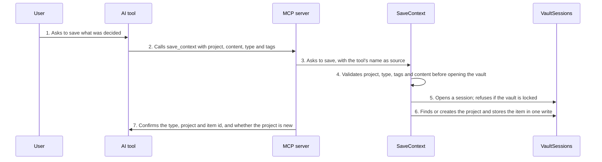

<!-- Generated by tools/living-docs — do not edit. Run `npm run docs`. -->

[← Guide](../README.md)

# Save context from an AI tool

*Theme: Working with context*

## Who

An AI tool (Claude Code, Claude Desktop, Cursor…) acting for the user, usually when the user says
"remember this" or at the end of a working session.

## Why

So that what was learned in one session (a decision and its reason, progress, a preference, a fact)
is available to any other tool, in any later session, on any of the user's machines.

## Business rules

- Context is saved per **project**, identified by a slug such as `demo-project`. A project that does
  not exist yet is created on the fly.
- An item has a type: `decision`, `progress`, `preference`, `fact` (the default) or `handoff`.
  An AI can never save an `imported` item.
- Content is trimmed, must not be empty and is capped at 32 KB: distilled context, not transcripts.
  Up to 10 lowercase tags. Secrets do not belong in context.
- The tool's name is recorded as the item's source.
- A save can name one outdated item in the same project it `supersedes`, by exact id; that item is
  archived in the same write as the new save — all or nothing. Pinned, imported and already archived
  items can never be superseded.
- Everything is validated before the vault is touched; a valid save advances the vault's lineage
  once, as one transaction.
- The vault must be unlocked; a locked vault refuses with a message telling the user how to unlock.
- The `save-context` prompt lets the user ask the AI to distil the whole session into one save.

## What can go wrong

- The vault is locked ([`VAULT_LOCKED`](../reference/errors.md#err-vault-locked)).
- Bad project name, type, tags or content ([`INVALID_PROJECT_NAME`](../reference/errors.md#err-invalid-project-name), [`INVALID_ITEM_TYPE`](../reference/errors.md#err-invalid-item-type),
  [`INVALID_TAG`](../reference/errors.md#err-invalid-tag), [`TOO_MANY_TAGS`](../reference/errors.md#err-too-many-tags), [`CONTENT_EMPTY`](../reference/errors.md#err-content-empty), [`CONTENT_TOO_LARGE`](../reference/errors.md#err-content-too-large)).
- The superseded item cannot be retired ([`INVALID_ITEM_ID`](../reference/errors.md#err-invalid-item-id), [`ITEM_NOT_FOUND`](../reference/errors.md#err-item-not-found),
  [`ITEM_PINNED`](../reference/errors.md#err-item-pinned), [`ITEM_ARCHIVED`](../reference/errors.md#err-item-archived), [`ITEM_NOT_CURATABLE`](../reference/errors.md#err-item-not-curatable)); nothing is saved then.

## How it works

### Entry points

- CLI: none — saving is done by AI tools through MCP (see the parity table)
- Desktop: none — the desktop app browses context, AI tools save it
- MCP: [`save_context`](../reference/mcp.md#mcp-save-context), prompt [`save-context`](../reference/mcp.md#prompt-save-context)

### Sequence

### Steps

1. **User → AI tool:** Asks to save what was decided — [`save-context`](../reference/mcp.md#prompt-save-context)
2. **AI tool → MCP server:** Calls `save_context` with project, content, type and tags — [`save_context`](../reference/mcp.md#mcp-save-context)
3. **MCP server → SaveContext:** Asks to save, with the tool's name as source — [`SaveContext`](../../../src/context/application/use-cases/save-context.use-case.ts)
4. **SaveContext → SaveContext:** Validates project, type, tags and content before opening the vault — [`parseContent`](../../../src/context/domain/values/content.ts)
5. **SaveContext → VaultSessions:** Opens a session; refuses if the vault is locked — [`SqliteVaultSessions`](../../../src/context/infra/vault-sessions.ts)
6. **SaveContext → VaultSessions:** Finds or creates the project and stores the item in one write — [`createContextItem`](../../../src/context/domain/entities/context-item.ts)
7. **MCP server → AI tool:** Confirms the type, project and item id, and whether the project is new

## Errors

- [`VAULT_LOCKED`](../reference/errors.md#err-vault-locked) — unlock the vault first.
- [`INVALID_PROJECT_NAME`](../reference/errors.md#err-invalid-project-name) — the project slug is not valid.
- [`INVALID_ITEM_TYPE`](../reference/errors.md#err-invalid-item-type) — the type is not one an AI may save.
- [`INVALID_TAG`](../reference/errors.md#err-invalid-tag) / [`TOO_MANY_TAGS`](../reference/errors.md#err-too-many-tags) — a tag is malformed, or there are too many.
- [`CONTENT_EMPTY`](../reference/errors.md#err-content-empty) / [`CONTENT_TOO_LARGE`](../reference/errors.md#err-content-too-large) — the content is empty or over 32 KB.
- [`INVALID_ITEM_ID`](../reference/errors.md#err-invalid-item-id) / [`ITEM_NOT_FOUND`](../reference/errors.md#err-item-not-found) — `supersedes` does not name an item in this project.
- [`ITEM_PINNED`](../reference/errors.md#err-item-pinned) / [`ITEM_ARCHIVED`](../reference/errors.md#err-item-archived) / [`ITEM_NOT_CURATABLE`](../reference/errors.md#err-item-not-curatable) — that item cannot be superseded.
