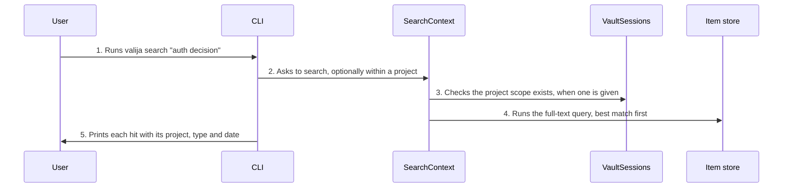

<!-- Generated by tools/living-docs — do not edit. Run `npm run docs`. -->

[← Guide](../README.md)

# Search saved context

*Theme: Working with context*

## Who

The user or an AI tool with a specific recall question, such as "what did we decide about auth?".

## Why

To find a piece of context by its words, across every project or within one, including imported
conversations that never appear in a context pack.

## Business rules

- Full-text search over item content and tags; every word must match.
- Search across all projects, or within one existing project.
- At most 100 results (20 by default), best match first.
- An empty query returns nothing instead of an error; special characters never break the search.
- Searching only reads; it never changes the vault.

## What can go wrong

- The vault is locked ([`VAULT_LOCKED`](../reference/errors.md#err-vault-locked)).
- The project given as scope does not exist ([`PROJECT_NOT_FOUND`](../reference/errors.md#err-project-not-found)).

## How it works

### Entry points

- CLI: [`valija search`](../reference/cli.md#cli-search) (`--project`)
- Desktop: [`content:search`](../reference/ipc.md#ipc-content-search)
- MCP: [`search_context`](../reference/mcp.md#mcp-search-context)

### Sequence

### Steps

1. **User → CLI:** Runs `valija search "auth decision"` — [`searchCommand`](../../../src/delivery/cli/content-commands.ts)
2. **CLI → SearchContext:** Asks to search, optionally within a project — [`SearchContext`](../../../src/context/application/use-cases/search-context.use-case.ts)
3. **SearchContext → VaultSessions:** Checks the project scope exists, when one is given
4. **SearchContext → Item store:** Runs the full-text query, best match first — [`SqliteContextItemRepository`](../../../src/context/infra/item-repo.ts)
5. **CLI → User:** Prints each hit with its project, type and date

## Errors

- [`VAULT_LOCKED`](../reference/errors.md#err-vault-locked) — unlock the vault first.
- [`PROJECT_NOT_FOUND`](../reference/errors.md#err-project-not-found) — the project given as scope does not exist.
