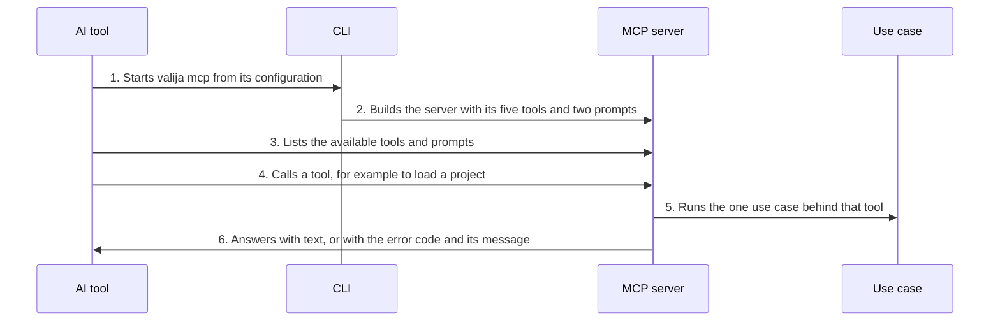

<!-- Generated by tools/living-docs — do not edit. Run `npm run docs`. -->

[← Guide](../README.md)

# Serve AI tools over MCP

*Theme: Connecting AI tools*

## Who

A connected AI tool. It starts Valija's MCP server itself; humans never run it directly.

## Why

MCP is how AI tools talk to Valija: through it they save, hand off, load, search and list context,
whichever tool and machine the user is on.

## Business rules

- The server speaks MCP over stdio and exposes exactly **five tools** — [`save_context`](../reference/mcp.md#mcp-save-context),
  [`save_handoff`](../reference/mcp.md#mcp-save-handoff), [`get_context`](../reference/mcp.md#mcp-get-context), [`search_context`](../reference/mcp.md#mcp-search-context), [`list_projects`](../reference/mcp.md#mcp-list-projects) — and
  **two prompts** — [`save-context`](../reference/mcp.md#prompt-save-context), [`load-context`](../reference/mcp.md#prompt-load-context).
- The surface is deliberately narrow: an AI can never pin items, delete them for good, create
  imported items, or unlock the vault.
- Each tool is a thin call into one use case; the vault's rules apply unchanged.
- When the vault is locked, every tool answers with a clear message asking the user to unlock it in
  a terminal or in the desktop app.
- The name of the calling tool is recorded as the source of what it saves.

## What can go wrong

- The vault is locked, or auto-locked while idle ([`VAULT_LOCKED`](../reference/errors.md#err-vault-locked)).
- A tool call carries invalid input; the matching Valija error code is returned to the AI.

## How it works

### Entry points

- CLI: [`valija mcp`](../reference/cli.md#cli-mcp) (run by AI tools, not by humans)
- Desktop: none — AI tools spawn the CLI's MCP server; the desktop app only configures them

### Sequence

### Steps

1. **AI tool → CLI:** Starts `valija mcp` from its configuration — [`runMcpServer`](../../../src/delivery/mcp/server.ts)
2. **CLI → MCP server:** Builds the server with its five tools and two prompts — [`buildMcpServer`](../../../src/delivery/mcp/server.ts)
3. **AI tool → MCP server:** Lists the available tools and prompts
4. **AI tool → MCP server:** Calls a tool, for example to load a project — [`get_context`](../reference/mcp.md#mcp-get-context)
5. **MCP server → Use case:** Runs the one use case behind that tool — [`Container`](../../../src/delivery/container.ts)
6. **MCP server → AI tool:** Answers with text, or with the error code and its message

## Errors

- [`VAULT_LOCKED`](../reference/errors.md#err-vault-locked) — the vault must be unlocked by the user.
