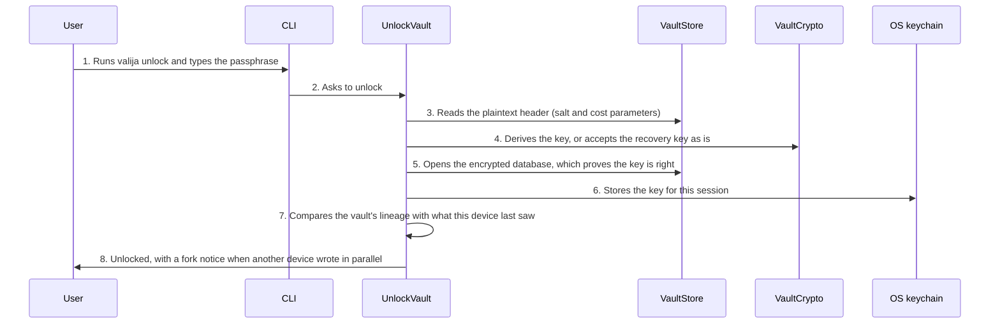

<!-- Generated by tools/living-docs — do not edit. Run `npm run docs`. -->

[← Guide](../README.md)

# Unlock the vault

*Theme: Vault lifecycle*

## Who

The vault owner, with their passphrase or their recovery kit, on a device where the vault lives.

## Why

While the vault is locked, no AI tool can read or save context. Unlocking opens it for this session
so the CLI, the desktop app and every connected AI tool can use it.

## Business rules

- The derived key is kept in the OS keychain for the session, never written to disk.
- The recovery kit's raw key (64 hex characters) works instead of the passphrase.
- If another device wrote to the vault in parallel (a **fork**), the vault still unlocks so the
  user can inspect it, and a notice says so. Nothing is ever deleted or merged automatically.
- An outdated schema is upgraded on unlock; see the upgrade flow.
- A vault a **newer** Valija already upgraded is never opened, downgraded or changed: the CLI and
  AI tools are refused with the vault's and this version's schema numbers, and the desktop app
  stops on an "Update Valija" screen that offers only Lock vault and Quit.
- Unlocking resets the idle auto-lock clock.

## What can go wrong

- Wrong passphrase or malformed recovery key ([`WRONG_PASSPHRASE`](../reference/errors.md#err-wrong-passphrase)) If the passphrase was changed on another device, the old one no longer works: the CLI adds a hint to use the new one, and the desktop copy says the same.
- No vault in this folder ([`VAULT_NOT_FOUND`](../reference/errors.md#err-vault-not-found)).
- The vault was upgraded by a newer Valija ([`VAULT_SCHEMA_TOO_NEW`](../reference/errors.md#err-vault-schema-too-new)).
- Another device wrote independently ([`VAULT_FORK_DETECTED`](../reference/errors.md#err-vault-fork-detected) is shown as a notice, not a failure).

## How it works

### Entry points

- CLI: [`valija unlock`](../reference/cli.md#cli-unlock) (passphrase prompt, or `--recovery-key`)
- Desktop: [`vault:unlock`](../reference/ipc.md#ipc-vault-unlock)

### Sequence

### Steps

1. **User → CLI:** Runs `valija unlock` and types the passphrase — [`unlockCommand`](../../../src/delivery/cli/vault-commands.ts)
2. **CLI → UnlockVault:** Asks to unlock — [`UnlockVault`](../../../src/vault/application/use-cases/unlock-vault.use-case.ts)
3. **UnlockVault → VaultStore:** Reads the plaintext header (salt and cost parameters) — [`VaultStore`](../../../src/vault/application/ports/vault-store.ts)
4. **UnlockVault → VaultCrypto:** Derives the key, or accepts the recovery key as is — [`resolveUnlockKey`](../../../src/vault/application/services/resolve-unlock-key.ts)
5. **UnlockVault → VaultStore:** Opens the encrypted database, which proves the key is right
6. **UnlockVault → OS keychain:** Stores the key for this session — [`OsKeychain`](../../../src/vault/infra/keyring.ts)
7. **UnlockVault → UnlockVault:** Compares the vault's lineage with what this device last saw — [`classifyLineage`](../../../src/vault/domain/services/vault-lineage.ts)
8. **UnlockVault → User:** Unlocked, with a fork notice when another device wrote in parallel

## Errors

- [`WRONG_PASSPHRASE`](../reference/errors.md#err-wrong-passphrase) — the passphrase or recovery key does not open the vault.
- [`VAULT_NOT_FOUND`](../reference/errors.md#err-vault-not-found) — there is no vault to unlock.
- [`VAULT_FORK_DETECTED`](../reference/errors.md#err-vault-fork-detected) — shown after unlocking; see the multi-device flow.
- [`VAULT_SCHEMA_TOO_NEW`](../reference/errors.md#err-vault-schema-too-new) — update Valija; nothing in the vault was changed.
