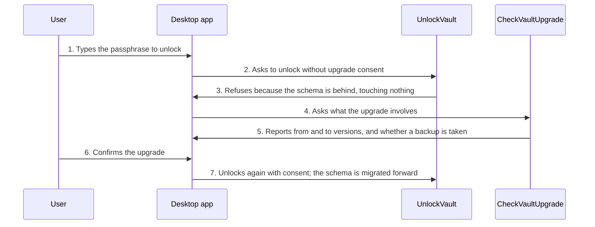

<!-- Generated by tools/living-docs — do not edit. Run `npm run docs`. -->

[← Guide](../README.md)

# Upgrade the vault on unlock

*Theme: Vault lifecycle*

## Who

A user who updated Valija and opens a vault created by an older version.

## Why

New versions sometimes change how data is stored. The vault is upgraded in place so nothing has to
be exported or re-imported, and old vaults keep working.

## Business rules

- Upgrades only ever move forward and never lose data.
- Upgrades that rebuild real data take a backup of the encrypted file first.
- The terminal upgrades silently as part of unlocking.
- The desktop app asks first: it shows which versions are involved and whether a backup is taken,
  and the user can decline (the vault then stays locked and untouched).

## What can go wrong

- The user declines the upgrade in the desktop app; the vault stays locked.
- An unlock without consent is refused ([`VAULT_UPGRADE_REQUIRED`](../reference/errors.md#err-vault-upgrade-required)) before anything is changed.
- A leftover backup file after a failed upgrade is reported by the setup check and by status.

## How it works

### Entry points

- CLI: [`valija unlock`](../reference/cli.md#cli-unlock) (upgrades silently)
- Desktop: [`vault:unlock`](../reference/ipc.md#ipc-vault-unlock), which refuses until [`vault:upgradeCheck`](../reference/ipc.md#ipc-vault-upgradecheck) has been shown and confirmed

### Sequence

### Steps

1. **User → Desktop app:** Types the passphrase to unlock — [`vault:unlock`](../reference/ipc.md#ipc-vault-unlock)
2. **Desktop app → UnlockVault:** Asks to unlock without upgrade consent — [`UnlockVault`](../../../src/vault/application/use-cases/unlock-vault.use-case.ts)
3. **UnlockVault → Desktop app:** Refuses because the schema is behind, touching nothing — [`VAULT_UPGRADE_REQUIRED`](../reference/errors.md#err-vault-upgrade-required)
4. **Desktop app → CheckVaultUpgrade:** Asks what the upgrade involves — [`CheckVaultUpgrade`](../../../src/vault/application/use-cases/check-vault-upgrade.use-case.ts)
5. **CheckVaultUpgrade → Desktop app:** Reports from and to versions, and whether a backup is taken — [`pendingMigrations`](../../../src/shared/infra/migrations.ts)
6. **User → Desktop app:** Confirms the upgrade
7. **Desktop app → UnlockVault:** Unlocks again with consent; the schema is migrated forward — [`LATEST_SCHEMA_VERSION`](../../../src/shared/infra/migrations.ts)

## Errors

- [`VAULT_UPGRADE_REQUIRED`](../reference/errors.md#err-vault-upgrade-required) — the schema is outdated and the upgrade was not confirmed.
- [`WRONG_PASSPHRASE`](../reference/errors.md#err-wrong-passphrase) — the passphrase does not open the vault (checked before upgrading).
